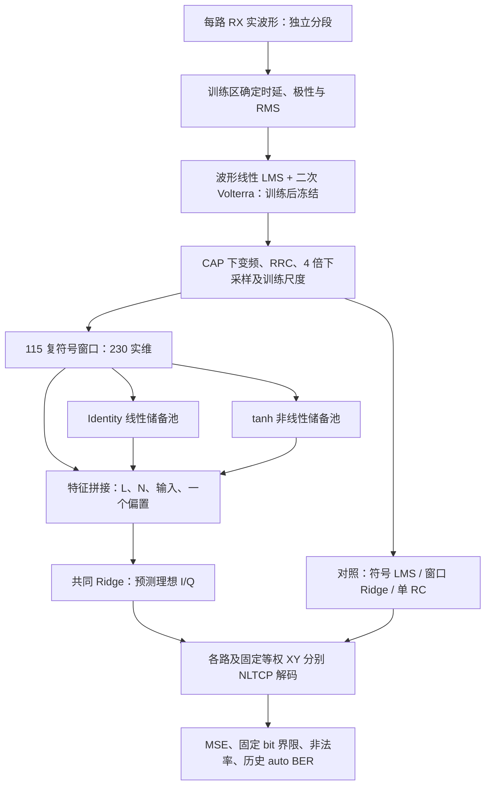
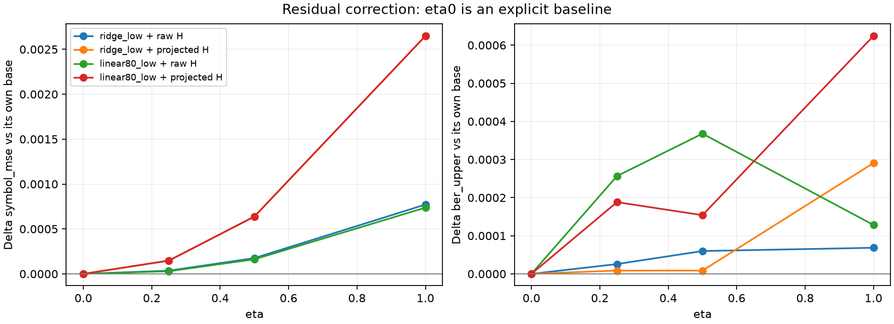
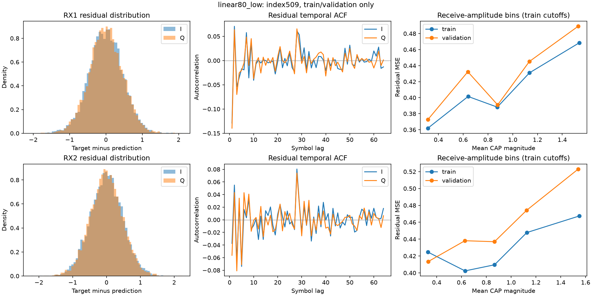

# DSP 五阶段研究总结与最终研究结论

核对日期：2026-10-17（America/Los_Angeles）。项目根目录：`/Users/oliver/Desktop/DSP`。本次只整理既有研究，不训练、不增加候选、不重评旧测试。第二组已经完成双分支特征融合的实现、消融及负面结果验证；尚未证明其稳定超过强线性基线。**最终研究决策：保留现有Volterra前端与115窗口强线性基线，停止扩大双分支/残差融合参数搜索。第五阶段已完成前端消融，删除二次项既恶化绝对误差，也没有显现双分支稳定增益。**

旧版已逐字节备份至[文档历史目录](document_history/2026-10-17_before_phase5_consolidation)；本版整合五阶段结论，未改动历史实验报告、代码或结果。

## 1. 系统背景与研究问题

数据来自 NLTCP 光通信实验。两路原始 PAM4 消息经过有记忆编码，形成 I/Q 六电平理想符号；CAP 波形经实际链路后，由两路接收序列 RX1/RX2 恢复理想复符号，再通过 NLTCP 解码恢复消息。每个复符号对应两份 PAM4 标签，共四个参考 bit。不能把六电平 I/Q 简单视作普通独立 36QAM 标签。

已确认 index509 的 RX1、RX2、Tx 波形各204800实采样，理想符号与两份标签各51200项，sps=4。输入文件位于 `NN数据20250320/NN数据20250320/`，准确清单见各阶段 `input_manifest.json` 和原审计 CSV。572对 NLTCP 文件齐全不等于572个独立消息；另外的16QAM、64APSK资料不能替代本任务真值。记录中的10 G采样设置缺少TXT导出/重采样日志，不无条件断言物理符号率。

当前研究是 **S2S（符号到符号）均衡**。原助教 RC 示例是64APSK W2S；本项目复用其固定储备池与岭读出机制，改变输入/标签接口，并纠正原示例测试阶段重新拟合的行为。原符号 LMS 是来源参数下的工程对照；115窗口 Ridge 是检验非线性增量价值的强线性对照。

双分支指**一个物理 RX 内的两种储备池**；RX1/RX2的0.5/0.5合并是另一个层次。所谓“线性基线”只指符号级模型：共同波形前端已经非线性。

## 2. 阶段索引与主要成果

用户的第一阶段包含原始数据审计；代码目录另将初始单RC命名为Phase1。以下保留原名，不改写历史。

|研究进程|权威资料（项目内路径）|解决的问题与结论|
|---|---|---|
|原始审计|`audit_outputs/2026-10-16/DSP数据审计报告.md`、`file_index.csv`|1670文件索引；509配对及4:1长度；RX2反相；理想符号与PAM4首尾不一致；发现原评价泄漏|
|初始单RC（代码Phase1）|`rc_baseline/PHASE1_REPORT.md`、`runs/index509_fixed_v1/`|Python S2S链路、独立分段、固定前端与LMS；25窗口RC在RX2失败，保留结果|
|诊断优化（Phase2）|`rc_baseline/runs/phase2_509/REPORT.md`|10候选验证；115窗口解决主要上下文不足；共享矩阵MATLAB数值检查；BER口径拆分|
|双分支（Phase3）|`rc_baseline/runs/phase3_feature_fusion/REPORT.md`|稳定Identity分支、共同读出；18候选、9个冻结消融、509/513/382；未稳定超越强线性|
|残差研究（Phase4）|`rc_baseline/runs/phase4_residual_fusion/REPORT.md`|24候选、两种设计×3固定非线性种子；残差预测/近似正交/分组惩罚/坐标等价；全部残差家族选择eta=0，止损|
|前端消融（Phase5）|`rc_baseline/runs/phase5_volterra_ablation/REPORT.md`|先冻结协议，2×2及强线性参照、固定三seed；仅训练/验证；关闭二次项性能下降，未释放双分支增益，止损|

旧报告中的“尚未运行MATLAB”“可进入残差研究”等是当时状态：Phase2已有部分实际MATLAB数值验证，Phase4已经完成残差研究，不能照搬旧建议为当前待办。

## 3. 数据协议与 BER 契约

|用途|完整符号区间，1-based|训练读出/计分区间|有效复符号|
|---|---|---|---:|
|训练|1–10000|129–9872|9744|
|验证|10001–20000|10129–19872|9744|
|历史保留测试|20001–51200|20129–51072|30944|

每段独立对齐、滤波、零填充、储备池重置及解码，双端保护128符号。115居中窗口包含未来57符号，属于离线处理；保守上下文要求98符号。训练段估计所有尺度、输出权重、投影及标准化统计；验证仅选参数，不回填训练。波形前端只更新训练段前10000**采样**，不是10000符号。509训练时lag=0、RX1极性+1、RX2−1；其他工况按其训练段确定，未硬套RX2反相。

NLTCP先把I/Q最近邻判为PAM6编号q，再计算

\[
 d_t=|q_t-\lfloor q_{t-1}/2\rfloor|.
\]

前后q为(0,4)、(0,5)、(1,4)、(1,5)、(2,5)、(3,5)时产生非法4/5。理想Tx直接解码，第2–51199项与标签一致；首尾不一致，来源待助教解释。所有有效mask内理想解码BER为0。非法值保持原样，不截断、不取模。

令N为有效复符号数，E为合法判决按自然二进制计算的错误bit数，U为非法I/Q分量总数：

\[
 BER_{lo}=E/(4N),\quad BER_{hi}=(E+2U)/(4N),\quad p_{invalid}=U/(2N).
\]

这是未知非法输出映射的**确定性界限，不是统计置信区间**；有非法值时不存在已确认的唯一固定2-bit BER。历史auto BER按I/Q各自最大整数决定2或3位，再平均两分量BER，分母可能不同于真实消息比特数。上下界与auto必须分列；不能只拿较小auto宣传。

509测试早已反复观察；513/382当时按元数据预选并冻结算法后评价，现在也都是历史测试。三工况共用Tx/标签，且分别用各自训练段拟合，属于**条件内校准后的跨工况验证，不是零样本迁移，也不是独立新载荷测试**。目前没有独立新消息盲测结果。Phase4与Phase5均仅用509训练/验证，没有新测试成绩。

## 4. 关键数学模型与预算

设z为CAP复符号，u为115窗口交错I/Q向量除以训练最大绝对值，\(\tilde u=[u;1]\)，Y为真实I/Q。

- 符号LMS：\(\hat y_t=w^T v_t,\ e_t=y_t-\hat y_t,\ w\leftarrow w+\mu e_t v_t^*\)，v为逆序复窗口。RX1/RX2步长0.0021/0.0011，训练后冻结。
- 强线性Ridge：\(F=[u,1]\)，直接拟合理想I/Q，没有储备池。
- 储备池：\(h_t=(1-\gamma)h_{t-1}+\gamma\phi(Ah_{t-1}+W_{in}\tilde u_t)\)，A和Win固定；Identity与tanh分别形成L、H。
- 共同读出：\(F=[L,H,u,1]\)，\(W=\arg\min_W\|F_{tr}W-Y_{tr}\|_F^2+\lambda\|W\|_F^2\)，预测两列还原复数。只保留一份直通和偏置；偏置也惩罚。实现用solve，不显式求逆。

线性A按算子2范数缩放至α=.6，不是谱半径=.6；γ=.7，故有效递归B满足\(\|B\|_2\le1-\gamma+\gamma\alpha=.72<1\)。非线性A谱半径.9，γ=.7。线性seed200、非线性seed100；实际矩阵保存，不能只靠跨语言同seed复现。

|模型|L/N节点|读出维度|监督实系数|固定随机系数|λ|
|---|---:|---:|---:|---:|---:|
|窗口Ridge|0/0|231|462|0|1e−5|
|线性RC80 / tanh80|80/0或0/80|311|622|24880|1e−5|
|主双分支dual40_reg|40/40|311|622|21680|.01|
|线性RC160 / tanh160|160/0或0/160|391|782|62560|1e−5|
|双分支80+80|80/80|391|782|49760|1e−5或.01|

同总节点/读出维度不等于同运算量；同λ预算消融另见Phase3完整表。主家族赢家λ不同，因此主赢家差异也不是仅改变分支结构的单因素实验。

残差模型先冻结线性基础B的读出，再拟合\(R_{tr}=Y_{tr}-B_{tr}W_B\)：

\[
 C=[u,L,1],\quad P=(C_{tr}^TC_{tr}+.01I)^{-1}C_{tr}^TH_{tr},\quad E_H=H-CP,
\]
\[
 V=[(E_H-\mu_{tr})/\sigma_{tr},1],\quad W_R=\operatorname{Ridge}(V_{tr},R_{tr};.01),\quad\hat Y=BW_B+\eta VW_R.
\]

原状态版本P=0；η∈{0,.25,.5,1}由验证选择。B分别为窗口Ridge或线性RC，不能混称；Ridge＋原状态控制中线性储备池虽物化却未参与预测。P有24880个训练拟合的无监督系数，应单列预算。线性RC残差读出共784监督系数，联合80+80为782；不是严格相同参数化。

P为Ridge投影，属近似正交化。对联合模型\(\widetilde F=FT,W=T\widetilde W\)，同时变换惩罚为\(\lambda\|T\widetilde W\|^2\)时仅是坐标变化，预测差约1.18e−11。变换后使用对角分组惩罚才改变正则先验；输入/L/H/偏置惩罚为.01/1/10/.01。顺序残差另引入冻结基础与收缩约束，不可将这些改变全归因于新信息或残差目标。

## 5. 统一对照：先验证，后历史测试

以下表格从保存的JSON生成，不重新推理或计分。MSE是原I/Q尺度的复数平方误差；聚合为RX1、RX2、XY等权平均，三者相关，不是三份独立试验。

|模型（509验证）|复数MSE均值|固定2-bit下界均值|上界均值|auto均值|非法率均值|
|---|---:|---:|---:|---:|---:|
|ridge_low|0.393878236|0.020696497|0.023159551|0.016255017|0.246305%|
|linear80_low|0.393680757|0.020705049|0.023150999|0.016243614|0.244595%|
|linear160_low|0.393719238|0.020824781|0.023287835|0.016340540|0.246305%|
|tanh80_low|0.396467816|0.020978722|0.023356253|0.016357645|0.237753%|
|dual40_reg|0.395261630|0.021286604|0.023629926|0.016528690|0.234332%|
|dual80_reg|0.396307942|0.021278051|0.023638478|0.016540093|0.236043%|
|res_linear80_low_raw_eta0.25|0.393709848|0.020927408|0.023407567|0.016426063|0.248016%|
|joint_std_group|0.396232392|0.021175424|0.023518747|0.016454570|0.234332%|
|joint_orth_group|0.396277803|0.021235290|0.023578612|0.016494481|0.234332%|

六个Phase3参考在Phase4验证预测逐元素一致，因此可同表比较。全部24配置与逐通道指标见Phase4原报告及metrics.csv；没有只展示获胜候选。最优非零残差的3seed平均MSE相对收益为−0.008000%（负值表示恶化），分组联合为−0.689276%。四个包含η=0的家族全选不修正。

历史初始RC25的509 auto（RX1/RX2/XY）为0.035995/0.092657/0.037816；扩窗RC115为0.018550/0.022525/0.006366。窗口控制在训练/验证完成，反相控制前端预测差0，整体幅相修正无实质改善，支持“上下文不足是主要可验证原因”，不支持“RX2物理信道恰好有115符号记忆”。

### 三工况历史测试：家族代表及LMS

各模型每条件有效30944复符号。下表每行同时列auto、固定bit界限、非法率和I/Q位宽；不能跨位宽仅按auto排序。没有Phase4/5测试行，因为均未执行测试评价。

|index|模型|输出|auto BER|固定2-bit下界–上界|非法率|I/Q位宽|
|---|---|---|---:|---|---:|---|
|509|ridge_low|RX1|0.0184042|0.0239626–0.0264025|0.24399%|3/3|
|509|ridge_low|RX2|0.0221529|0.0284869–0.0316701|0.31832%|3/3|
|509|ridge_low|XY|0.0061563|0.0079660–0.0088224|0.08564%|3/3|
|509|linear80_low|RX1|0.0184096|0.0239465–0.0264025|0.24560%|3/3|
|509|linear80_low|RX2|0.0220775|0.0283981–0.0315651|0.31670%|3/3|
|509|linear80_low|XY|0.0060970|0.0079014–0.0087416|0.08402%|3/3|
|509|tanh80_low|RX1|0.0185496|0.0241404–0.0266126|0.24722%|3/3|
|509|tanh80_low|RX2|0.0225246|0.0288020–0.0321468|0.33448%|3/3|
|509|tanh80_low|XY|0.0063663|0.0082084–0.0091132|0.09049%|3/3|
|509|dual40_reg|RX1|0.0185227|0.0241161–0.0265722|0.24560%|3/3|
|509|dual40_reg|RX2|0.0225946|0.0291010–0.0323164|0.32155%|3/3|
|509|dual40_reg|XY|0.0061940|0.0080468–0.0088870|0.08402%|3/3|
|509|lms|RX1|0.0437888|0.0608357–0.0641158|0.32801%|3/3|
|509|lms|RX2|0.0275605|0.0370104–0.0399189|0.29085%|3/3|
|509|lms|XY|0.0136052|0.0193333–0.0200604|0.07271%|3/3|
|513|ridge_low|RX1|0.0087793|0.0103817–0.0122399|0.18582%|3/3|
|513|ridge_low|RX2|0.0152157|0.0190021–0.0215551|0.25530%|3/3|
|513|ridge_low|XY|0.0045566|0.0055746–0.0064148|0.08402%|3/3|
|513|linear80_low|RX1|0.0088978|0.0105594–0.0124176|0.18582%|3/3|
|513|linear80_low|RX2|0.0150972|0.0188486–0.0213854|0.25368%|3/3|
|513|linear80_low|XY|0.0044866|0.0054696–0.0063098|0.08402%|3/3|
|513|tanh80_low|RX1|0.0089840|0.0107614–0.0125711|0.18097%|3/3|
|513|tanh80_low|RX2|0.0153934|0.0193172–0.0218378|0.25207%|3/3|
|513|tanh80_low|XY|0.0045351|0.0054453–0.0063502|0.09049%|3/3|
|513|dual40_reg|RX1|0.0088978|0.0105594–0.0124176|0.18582%|3/3|
|513|dual40_reg|RX2|0.0153772|0.0190505–0.0217328|0.26823%|3/3|
|513|dual40_reg|XY|0.0045405|0.0055019–0.0063744|0.08725%|3/3|
|513|lms|RX1|0.0118763|0.0153665–0.0169984|0.16320%|3/3|
|513|lms|RX2|0.0188997|0.0249887–0.0272347|0.22460%|3/3|
|513|lms|XY|0.0058762|0.0077236–0.0084507|0.07271%|3/3|
|382|ridge_low|RX1|0.0046105|0.0058089–0.0065522|0.07433%|3/3|
|382|ridge_low|RX2|0.0092964|0.0117389–0.0132093|0.14704%|3/3|
|382|ridge_low|XY|0.0003070|0.0004120–0.0004444|0.00323%|3/3|
|382|linear80_low|RX1|0.0046428|0.0057846–0.0065764|0.07918%|3/3|
|382|linear80_low|RX2|0.0091994|0.0116420–0.0130801|0.14381%|3/3|
|382|linear80_low|XY|0.0003366|0.0003959–0.0004120|0.00162%|3/2|
|382|tanh80_low|RX1|0.0049121|0.0060432–0.0069319|0.08887%|3/3|
|382|tanh80_low|RX2|0.0098242|0.0122156–0.0138961|0.16805%|3/3|
|382|tanh80_low|XY|0.0003393|0.0003716–0.0004040|0.00323%|3/2|
|382|dual40_reg|RX1|0.0046320|0.0057685–0.0065602|0.07918%|3/3|
|382|dual40_reg|RX2|0.0095064|0.0120298–0.0135164|0.14866%|3/3|
|382|dual40_reg|XY|0.0002908|0.0003878–0.0004201|0.00323%|3/3|
|382|lms|RX1|0.0061563|0.0078771–0.0087820|0.09049%|3/3|
|382|lms|RX2|0.0134867|0.0178548–0.0194383|0.15835%|3/3|
|382|lms|XY|0.0005871|0.0008079–0.0008564|0.00485%|3/3|

382 XY是必须保留的反例：dual40 auto小于tanh80，但固定上界反而较高；tanh80上界低于Ridge下界，是一个局部收益，不支持双分支普遍优势。主双分支优于本轮固定参数LMS不意味着优于充分调优LMS；强线性RC/Ridge已解释了大部分收益。

## 6. 第五阶段：Volterra 前端消融与最终决策

**保留当前波形线性LMS＋二次Volterra前端；停止扩大当前双分支及残差融合搜索。** 第五阶段已实际完成，替代旧版“建议进行前端消融”的待办。它没有支持“删除二次项便能显现当前双分支的增量价值”。

协议先冻结，再进行小样本与正式训练；仅index509训练/验证，未预测或评分旧测试。主2×2匹配115窗口、总80节点、311维读出、λ=.01；线性seed200，tanh固定100/101/102全报。另有两前端下窗口Ridge与linear80的λ1e−5强线性参照。共12个组合、24个通道后端模型、4个共享前端，没有追加候选。

“无Volterra”严格指**删除二次基函数、保留并从零重新拟合波形线性LMS**；没有绕过整个前端，没有仅将二次学习率设0，也没有沿用已联合训练的W。原抽头/步长/单遍训练不变，前端只用训练前10000采样。对齐/极性共享，wave/CAP/输入尺度各自训练拟合，CAP和保护区固定；每侧后端重新拟合。四路训练相关峰均lag0；on的W/V和训练CAP与历史模型逐元素一致；跨on/off的后端A/Win相同。

下表全部为**验证**结果：每输出9744复符号，先平均RX1/RX2/XY，再对双分支三个seed平均各自指标；不是平均预测构造新集成模型。线性只训练一次。各输出相关，不是独立重复；各次评分I/Q均为3/3位，auto仍不是固定2-bit物理BER。下界/上界保持非法4/5未定义映射的原语义。

|前端|后端（λ=.01）|验证MSE|固定2-bit下界–上界|历史auto BER|非法判决率|
|---|---|---:|---|---:|---:|
|保留Volterra|线性RC80|0.393639194|0.020756363–0.023202313|0.016277823|0.24459%|
|保留Volterra|双分支40+40，三seed均值|0.395329417|0.021015782–0.023410418|0.016399456|0.23946%|
|仅波形线性LMS|线性RC80|0.543098019|0.041333128–0.046515805|0.032703886|0.51827%|
|仅波形线性LMS|双分支40+40，三seed均值|0.545271134|0.041937489–0.047205688|0.033190415|0.52682%|

两个低正则强线性参照同样未被off双分支稳定超过。双分支相对同前端匹配线性RC的平均MSE差：on为+0.001690223，off为+0.002173114。交互定义为 `(dual_off−linear_off)−(dual_on−linear_on)`，负值才支持删除二次项后增量变大；实测为 **+0.000482891**，三seed点估计均正。

|交互指标|256符号块，95%探索性区间|512符号块，95%探索性区间|
|---|---|---|
|MSE差中差|+0.000214275 … +0.000727679|+0.000220560 … +0.000731419|
|固定BER上界差中差|−0.000028579 … +0.001046370|+0.000019955 … +0.001094691|

每种块长2000次配对移动块，seed404，先解码再抽逐符号损失，四格/通道/seed保持相同位置。MSE交互方向不支持原假设；BER交互在256块长跨0，证据更弱，不能将两者混称为显著。on侧seed101的BER上界曾略低于主线性对照，但MSE仍差，不能据此挑seed。

止损不是临时追认：预声明要求off双分支三seed均降低相对两个off强线性参照的MSE且不恶化BER上界，两种块长的两指标区间支持改善，交互MSE区间支持负值。本次未通过，保存的decision.json明确 `promising_for_new_payload=false`、`search_expanded=false`、`test_evaluated=false`。连同Phase4四家族均选eta=0，继续在同一验证区追加参数缺乏现有证据支持。

**结论边界：** 此处支持在当前index509及固定训练规范下保留Volterra，并不证明其消除了全部非线性，也不否定其他非线性模型。off前端未优化步长/遍数，线性W随基函数删除重新训练，因此比较的是两个训练管线，不是其他系数固定时纯二次项的孤立因果贡献。验证区已多次使用、只固定一个线性seed，没有独立新载荷测试；不能把探索性区间称为总体确认性证据。

[Phase5完整报告](rc_baseline/runs/phase5_volterra_ablation/REPORT.md)保留所有逐通道/seed指标、尺度、参数和时间；[冻结协议](rc_baseline/runs/phase5_volterra_ablation/protocol.json)、[交互原始统计](rc_baseline/runs/phase5_volterra_ablation/paired_block_results.json)、[停止决策](rc_baseline/runs/phase5_volterra_ablation/decision.json)可核查。4项新测试、四条小样本路径、72条保存指标复核通过；这些是Phase5已保存证据，本次文档更新未重跑。

## 7. 证据、失败与未证实假设

**已证实（限当前协议与数据）：** 固定矩阵RC机制可复现；115上下文显著改善旧RX2；双分支实现稳定且可持久化；总节点/读出预算控制下未稳定胜过线性RC；非线性状态独特性不等于预测价值；标准化/分组惩罚可改善条件数，但没有带来验证收益。

Phase4残差验证增量R²在全部四种基础/状态组合、三种输出均为负；训练增量为正。外层星座约23.4%符号贡献约28%残差能量，RX1一阶残差ACF约−.13，幅度相关约.07–.08，说明残差有结构，但未证明当前tanh状态能够泛化预测。固定3个非线性seed也未通过事前门槛；256/512连续块重采样保留时间相关，其区间来自反复使用且已选模的验证集，只能作探索性检查。

**明确失败案例：** 原25窗口RC的RX2；纯状态80+80删除输入直通后验证上界均值约.380414；所有非零η残差方案未胜各自零修正基线；分组Ridge改善增广条件数至约480–565仍未胜线性基线。数值审计曾在未评分边界超临时阈值，完整失败日志保留；既定有效mask最大SVD预测差7.49e−9，未因失败改mask/权重。

**已检验但未获支持：** 关闭前端二次项能够释放当前双分支RC增量收益。**尚未证实：** Volterra究竟消除了多少可恢复非线性信息；其他载荷是否同样表现；更广非线性模型是否有用；课程是否要求超越强线性基线；非法PAM4最终输出规则。停止当前搜索不等于证明所有非线性无价值。

MATLAB共享矩阵fixture已实际核对：状态差1.08e−15、读出5.17e−14、预测3.91e−14，LMS/Volterra和解码机制亦通过。`rcosdesign`/`biterr`工具箱运行受阻，未完成完整CAP逐样本认证；NumPy/MATLAB同seed产生不同矩阵。不能称整个原始接收机已bit-for-bit复刻。

## 8. 可展示图表与核查入口

星座图使用原Phase3各index目录的`constellation_rx1/rx2/xy.png`；参数预算、计时为单次本机墙钟，不含共同前端，不能当实时部署结论。例：Phase4 RX1每10000符号，Ridge训练/推理.01370/.00304秒，linear80 .05166/.03277秒，dual40 .06938/.06182秒，非零残差C13 .15740/.10656秒；不是用更多运算换来稳定收益。

上一版交接核对覆盖报告、源码/测试、协议、JSON/CSV指标及保存结果目录；72个JSON、6个CSV、20个Python文件完成只读解析/语法检查，344个既有研究/审计/MATLAB文件建立前后哈希保护。23/23为Phase4已保存测试记录，本轮没有重跑训练或测试。原始大数据完整性依据既有审计和各输入manifest；本轮未重扫全部原始数据。当前目录不是Git仓库，不虚构提交号。交接命令、运行限制见[GROUP2_HANDOFF.md](GROUP2_HANDOFF.md)；原静态方案已由Phase5执行完成；[下一步决策](NEXT_EXPERIMENT_FEASIBILITY.md)现已更新，不再建议重复前端消融。

## 9. 可直接向组员展示的最终结论与下一步

> 第二组完成了线性RC与非线性RC的特征拼接及共同Ridge读出，并建立了长窗口强线性、预算匹配、残差预测和前端消融对照。在当前数据与协议下，双分支没有稳定超过强线性基线；残差修正选择不修正，移除Volterra二次项则使误差上升且没有释放双分支优势。因此保留Volterra＋115窗口强线性参照，停止扩大当前搜索。贡献是可信实现、可复验消融和明确适用边界，不是未经证实的融合性能提升。

下一步只推进团队统一报告：保留双分支作为本组主方法和负面结果，强线性作为推荐参照；与助教确认非法PAM4规则、课程比较目标及S2S要求。若要作新消息泛化宣称，先补齐不同Tx载荷的RX/标签/理想符号及来源证明。获得新数据或新机制本身不自动启动训练，必须另立固定协议；当前没有等待执行的扩大搜索。已有历史测试仅供回归，不恢复盲测性质。
