# DSP 第三阶段：线性＋非线性 RC 特征融合

**已完成实现、18项测试、小样本验证、18个预定义配置的验证搜索，以及冻结后的3工况统一评价。结论：双分支在本轮受控实验中没有稳定超越115窗口线性 Ridge 或最强单分支；不应宣称结构性优势。**

新增代码和结果独立保存，前两阶段源码与结果的哈希全部保持不变。509为历史保留集回归；513和382为按采集元数据预选的额外工况，算法冻结后才评价。它们共用载荷，不能作为独立随机消息的盲测证据。

## 1. 实现与数学定义

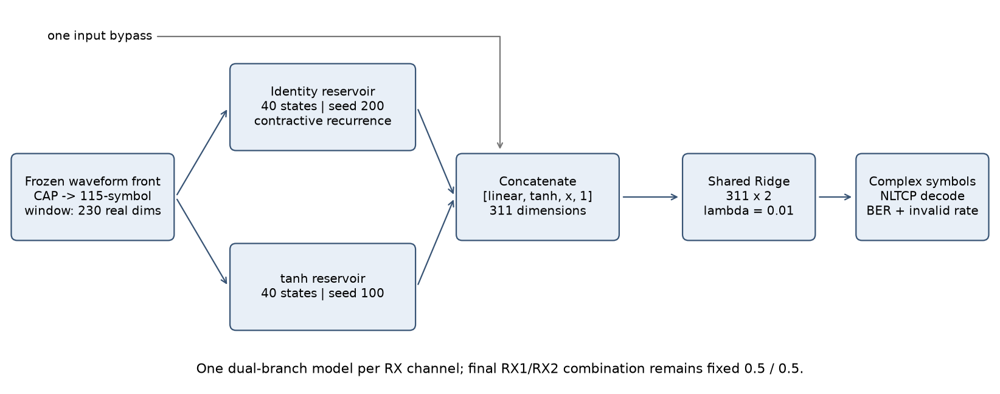

每个RX物理通道内，使用相同的CAP符号与115复符号居中窗口。230实维输入按训练有效窗口的绝对最大值缩放。两储备池独立固定随机矩阵；线性seed=200，非线性seed=100；两路物理RX使用相同seed策略，但各自拟合归一化与读出。

$$u_t=\operatorname{vec}_{IQ}(z_{t-57:t+57})/s_{train},\quad \tilde u_t=[u_t;1].$$

$$h^L_t=(1-\gamma_L)h^L_{t-1}+\gamma_L(A_Lh^L_{t-1}+W^L_{in}\tilde u_t),$$

$$h^N_t=(1-\gamma_N)h^N_{t-1}+\gamma_N\tanh(A_Nh^N_{t-1}+W^N_{in}\tilde u_t).$$

$$F_t=[h^L_t,h^N_t,u_t,1],\quad W_{out}=(F_{tr}^{T}F_{tr}+\lambda I)^{-1}F_{tr}^{T}Y_{tr},\quad \hat z_t=(F_tW_{out})_1+j(F_tW_{out})_2.$$

代码以`solve`求解而不显式求逆，偏置也正则化。主方法拼接状态后，保留原RC的一份输入直通与一份偏置；没有把两个分支各自完整features重复拼接。另单列严格状态拼接`[hL,hN,1]`消融。所有输出是原始I/Q尺度，再经现有NLTCP判决；测试不做增益重估。

### 线性分支稳定性

令随机矩阵 $G$，设置 $A_L=\alpha G/\|G\|_2$，$0\leq\alpha<1$、$0<\gamma_L\leq1$。于是有效递归 $B_L=(1-\gamma_L)I+\gamma_L A_L$ 满足 $\|B_L\|_2\leq1-\gamma_L+\gamma_L\alpha<1$。这比只限制特征值更强，保证初态扰动收缩且有界输入不会发散。

线性配置中的`linear_norm`是算子范数目标，**不是谱半径**；真实谱半径同时落盘。选定40节点线性分支：α=0.6、γ=0.7，A谱半径0.306885，B谱半径0.500085、2-范数0.626822；保守收缩界0.72，128步初态残留界5.48e−19。它只界定初态差，不是对持续输入或全部边界伪影的误差保证。每段重置确保不跨split携带状态。tanh分支沿用A谱半径0.9、γ=0.7。

## 2. 数据、同步和评估独立性

原始路径由既有`load_assets`和审计CSV确认，每个条件7文件校验SHA-256；204800波形采样/4=51200复符号。复用共同波形LMS/Volterra、CAP/RRC、固定phase=0；本实验仍是S2S，并非W2S。前端本身已有二次Volterra项，因此所谓“线性基线”仅指符号均衡器，不代表整条接收机全线性。

|index|bias / VPP|用途|元数据位置|
|---|---|---|---|
|509|30 mA / 200 mV|训练＋验证开发；旧测试回归|等高线图 row8|
|513|30 mA / 300 mV|预选幅度变化工况|等高线图 row9|
|382|50 mA / 200 mV|预选偏置变化工况|等高线图 row28|

三行AWG/OSC均10/10 G、roll-off=0.105、衰减13/15/2。选择时只读取条件列1–8和index列12，排除历史BER列9–11；完整对文件由审计索引确认。协议时间和内容先于模型搜索与新工况波形加载保存。

三工况元数据指向同一`RF0.105_data36QAM.txt`，同一v1/v2与两份PAM4标签哈希完全一致。新工况训练区与同一Tx的符号相关峰在lag=0（513 RX1/RX2约0.964/0.939；382约0.961/0.934），支持复用载荷。没有逐采集独立Tx文件或发射随机种子记录，不能证明仪器级每一比特的独立重发过程。当前证据明确不足以称为不同消息泛化。各模型只拟合各自训练区；509测试标签在过去已被看过，也对应新采集的同一载荷位置，因此跨工况结果仅作条件验证。

新工况不是零样本迁移：锁定509选出的架构/超参数后，用每个工况前10000符号独立训练前端、归一化、读出和LMS。新工况验证区没有用于拟合或选模。509前端直接加载第一阶段固定模型；新工况训练诊断均lag=0、RX1/RX2极性+1，与509 RX2极性−1不同，未硬套历史符号。

|区间(1-based)|原始区间|训练/计分区间|复符号数|
|---|---|---|---|
|train|1–10000|129–9872|9744|
|validation|10001–20000|10129–19872|9744|
|test|20001–51200|20129–51072|30944|

所有方法共享split、两端128保护、单段零填充、独立递归状态与解码。现有保守上下文检查需98符号，小于128；递归记忆并非硬截断，但绝不从另一段取状态。标签不用于初始化NLTCP前驱。每测试条件123776个真实参考bit。居中窗口含未来57符号，是离线处理。全部缩放仅在训练有效窗口拟合；分支状态没有额外标准化。

## 3. 搜索规则、消融与验证结果

共18个预定义主要配置，两路使用同一个候选配置；没有挑seed。A:两种ridge；B/C:80与160节点×两种ridge；D:40+40与80+80×两种ridge，额外α=0.3/0.9、γL=1、纯状态各1种。其余默认α=0.6、γL=0.7、γN=0.7、ρN=0.9。ridge为1e−5或0.01。

按RX1/RX2/XY验证固定2-bit上界的等权平均，在每个A/B/C/D家族内独立选最小值；平局依次比平均MSE、特征维度、名字。这三个输出相关，不被当作三个独立重复试验；等权平均仅是预定工程目标。每家族最优加7个预定预算/直通消融的并集，共9个模型统一最终评价。没有根据新工况结果更换家族代表。

|候选|RX1上界|RX2上界|XY上界|三输出均值|家族选定|
|---|---|---|---|---|---|
|ridge_low|0.027401|0.032122|0.009955|0.023160|是|
|tanh80_low|0.027299|0.032456|0.010314|0.023356|是|
|linear80_low|0.026991|0.032097|0.010365|0.023151|是|
|tanh160_low|0.027940|0.033790|0.010186|0.023972||
|linear160_low|0.027299|0.032174|0.010391|0.023288||
|dual40_low|0.027709|0.032456|0.010776|0.023647||
|dual80_low|0.027401|0.033149|0.010673|0.023741||
|ridge_reg|0.027453|0.032122|0.009981|0.023185||
|tanh80_reg|0.027299|0.032456|0.010314|0.023356||
|linear80_reg|0.027299|0.032045|0.010263|0.023202||
|tanh160_reg|0.027940|0.033764|0.010186|0.023963||
|linear160_reg|0.027222|0.032174|0.010417|0.023271||
|dual40_reg|0.027632|0.032533|0.010725|0.023630|是|
|dual80_reg|0.027376|0.032943|0.010596|0.023638||
|dual80_norm03|0.027401|0.033200|0.010699|0.023767||
|dual80_norm09|0.027453|0.033303|0.010622|0.023792||
|dual80_leak1|0.027325|0.033405|0.010802|0.023844||
|dual80_states_only|0.382133|0.382800|0.376308|0.380414||

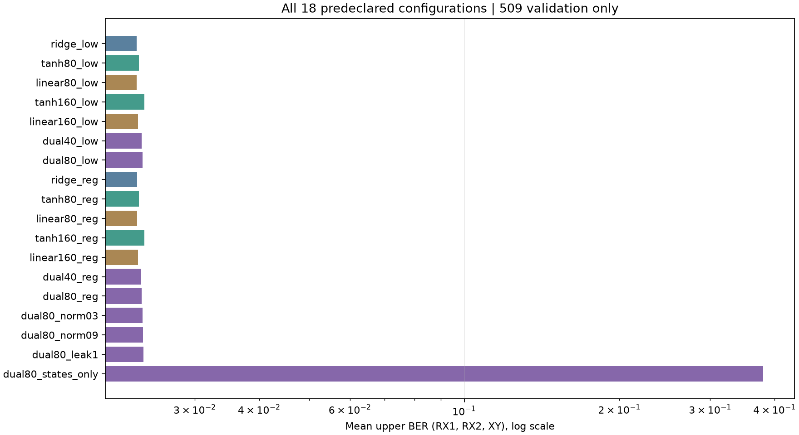

## 4. 冻结测试对照

下表先列历史兼容的MATLAB自动位宽BER，随后列完整可解释指标。**自动位宽BER不是固定2-bit物理BER**；尤其382合并结果发生I/Q位宽差异，不能只按第一张表排序。所有工况权重先保存并写哈希，再执行一次统一evaluate；推理后哈希不变。509原RC和LMS测试预测及mask与第二阶段逐元素一致。

### index=509

|模型|RX1 auto BER|RX2 auto BER|XY auto BER|
|---|---|---|---|
|ridge_low|0.018404|0.022153|0.006156|
|tanh80_low|0.018550|0.022525|0.006366|
|linear80_low|0.018410|0.022078|0.006097|
|dual40_reg|0.018523|0.022595|0.006194|
|tanh160_low|0.019336|0.023117|0.006512|
|linear160_low|0.018399|0.022137|0.006049|
|dual40_low|0.018469|0.022433|0.006199|
|dual80_low|0.018555|0.022632|0.006312|
|dual80_states_only|0.256463|0.255984|0.250695|
|lms|0.043789|0.027561|0.013605|

|模型|输出|固定2-bit界限|非法率|非法数|I/Q自动位宽|
|---|---|---|---|---|---|
|ridge_low|RX1|0.023963–0.026403|0.2440%|151|3/3|
|ridge_low|RX2|0.028487–0.031670|0.3183%|197|3/3|
|ridge_low|XY|0.007966–0.008822|0.0856%|53|3/3|
|tanh80_low|RX1|0.024140–0.026613|0.2472%|153|3/3|
|tanh80_low|RX2|0.028802–0.032147|0.3345%|207|3/3|
|tanh80_low|XY|0.008208–0.009113|0.0905%|56|3/3|
|linear80_low|RX1|0.023946–0.026403|0.2456%|152|3/3|
|linear80_low|RX2|0.028398–0.031565|0.3167%|196|3/3|
|linear80_low|XY|0.007901–0.008742|0.0840%|52|3/3|
|dual40_reg|RX1|0.024116–0.026572|0.2456%|152|3/3|
|dual40_reg|RX2|0.029101–0.032316|0.3215%|199|3/3|
|dual40_reg|XY|0.008047–0.008887|0.0840%|52|3/3|
|lms|RX1|0.060836–0.064116|0.3280%|203|3/3|
|lms|RX2|0.037010–0.039919|0.2908%|180|3/3|
|lms|XY|0.019333–0.020060|0.0727%|45|3/3|

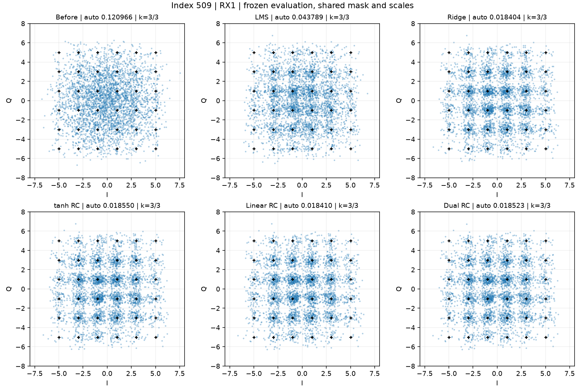

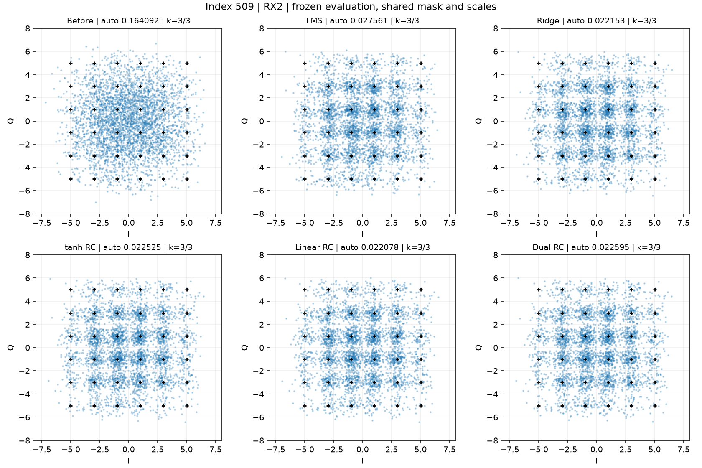

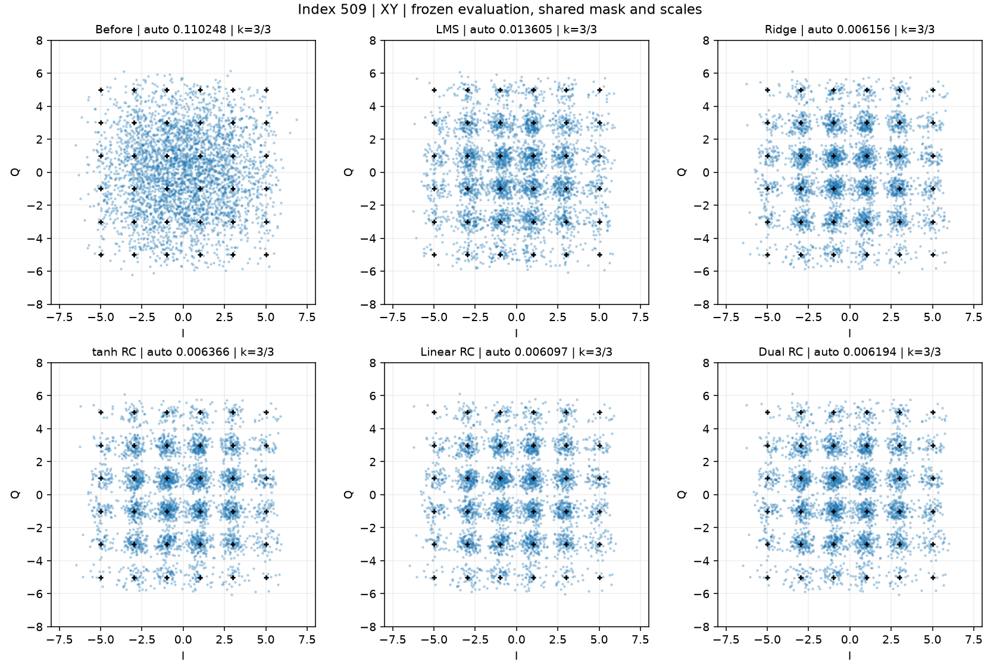

### index=513

|模型|RX1 auto BER|RX2 auto BER|XY auto BER|
|---|---|---|---|
|ridge_low|0.008779|0.015216|0.004557|
|tanh80_low|0.008984|0.015393|0.004535|
|linear80_low|0.008898|0.015097|0.004487|
|dual40_reg|0.008898|0.015377|0.004540|
|tanh160_low|0.009022|0.015894|0.004584|
|linear160_low|0.008898|0.015086|0.004497|
|dual40_low|0.008817|0.015340|0.004551|
|dual80_low|0.009059|0.015270|0.004540|
|dual80_states_only|0.252553|0.255224|0.249370|
|lms|0.011876|0.018900|0.005876|

|模型|输出|固定2-bit界限|非法率|非法数|I/Q自动位宽|
|---|---|---|---|---|---|
|ridge_low|RX1|0.010382–0.012240|0.1858%|115|3/3|
|ridge_low|RX2|0.019002–0.021555|0.2553%|158|3/3|
|ridge_low|XY|0.005575–0.006415|0.0840%|52|3/3|
|tanh80_low|RX1|0.010761–0.012571|0.1810%|112|3/3|
|tanh80_low|RX2|0.019317–0.021838|0.2521%|156|3/3|
|tanh80_low|XY|0.005445–0.006350|0.0905%|56|3/3|
|linear80_low|RX1|0.010559–0.012418|0.1858%|115|3/3|
|linear80_low|RX2|0.018849–0.021385|0.2537%|157|3/3|
|linear80_low|XY|0.005470–0.006310|0.0840%|52|3/3|
|dual40_reg|RX1|0.010559–0.012418|0.1858%|115|3/3|
|dual40_reg|RX2|0.019051–0.021733|0.2682%|166|3/3|
|dual40_reg|XY|0.005502–0.006374|0.0873%|54|3/3|
|lms|RX1|0.015366–0.016998|0.1632%|101|3/3|
|lms|RX2|0.024989–0.027235|0.2246%|139|3/3|
|lms|XY|0.007724–0.008451|0.0727%|45|3/3|

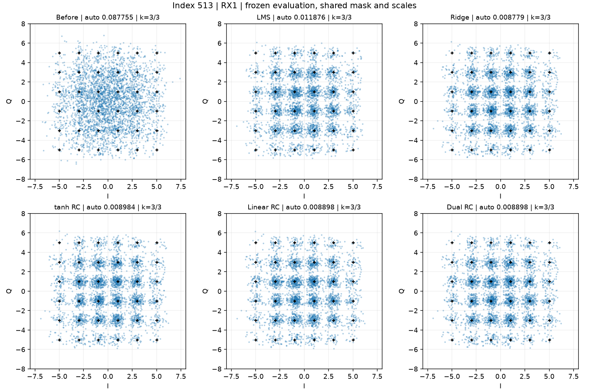

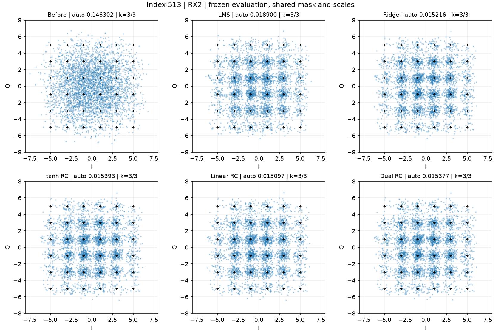

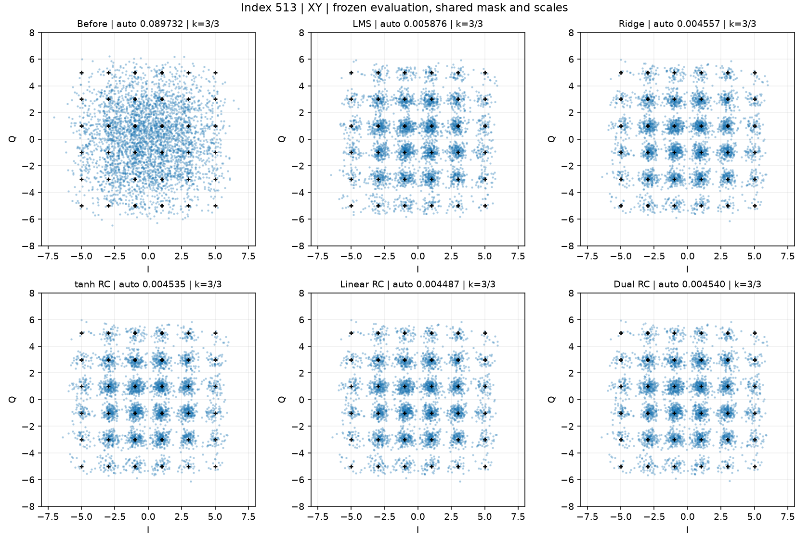

### index=382

|模型|RX1 auto BER|RX2 auto BER|XY auto BER|
|---|---|---|---|
|ridge_low|0.004610|0.009296|0.000307|
|tanh80_low|0.004912|0.009824|0.000339|
|linear80_low|0.004643|0.009199|0.000337|
|dual40_reg|0.004632|0.009506|0.000291|
|tanh160_low|0.005031|0.010471|0.000393|
|linear160_low|0.004627|0.009194|0.000358|
|dual40_low|0.004659|0.009560|0.000291|
|dual80_low|0.004864|0.009803|0.000342|
|dual80_states_only|0.254842|0.258246|0.253539|
|lms|0.006156|0.013487|0.000587|

|模型|输出|固定2-bit界限|非法率|非法数|I/Q自动位宽|
|---|---|---|---|---|---|
|ridge_low|RX1|0.005809–0.006552|0.0743%|46|3/3|
|ridge_low|RX2|0.011739–0.013209|0.1470%|91|3/3|
|ridge_low|XY|0.000412–0.000444|0.0032%|2|3/3|
|tanh80_low|RX1|0.006043–0.006932|0.0889%|55|3/3|
|tanh80_low|RX2|0.012216–0.013896|0.1680%|104|3/3|
|tanh80_low|XY|0.000372–0.000404|0.0032%|2|3/2|
|linear80_low|RX1|0.005785–0.006576|0.0792%|49|3/3|
|linear80_low|RX2|0.011642–0.013080|0.1438%|89|3/3|
|linear80_low|XY|0.000396–0.000412|0.0016%|1|3/2|
|dual40_reg|RX1|0.005768–0.006560|0.0792%|49|3/3|
|dual40_reg|RX2|0.012030–0.013516|0.1487%|92|3/3|
|dual40_reg|XY|0.000388–0.000420|0.0032%|2|3/3|
|lms|RX1|0.007877–0.008782|0.0905%|56|3/3|
|lms|RX2|0.017855–0.019438|0.1584%|98|3/3|
|lms|XY|0.000808–0.000856|0.0048%|3|3/3|

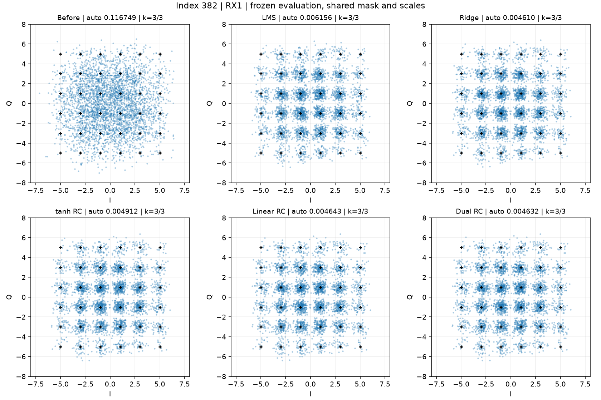

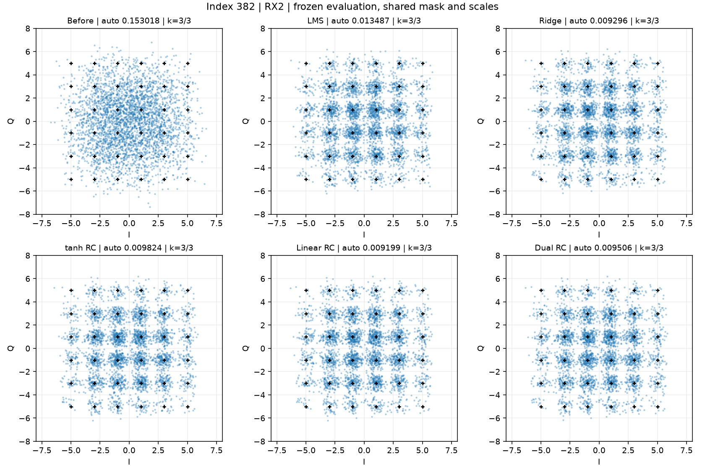

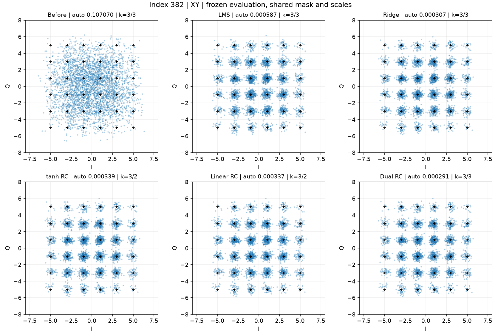

### BER解释与不能忽略的反例

保持原解码 $d_t=|q_t-\lfloor q_{t-1}/2\rfloor|$，预测可为非法4/5，不截断、不取模、不强制映射。合法判决比特错误数E，非法分量数U，有效复符号数N：$E/(4N)\le BER_{2bit}\le(E+2U)/(4N)$。非法率为U/(2N)。上下界是未知映射的确定性范围，不是置信区间；全部计数、每分量位宽和MSE见JSON/CSV。

382 XY中，双分支auto=0.000291小于tanh80的0.000339，但两者位宽分别3/3和3/2，固定上界分别0.000420和0.000404，排序相反。tanh80固定上界0.000404甚至低于Ridge下界0.000412，说明该单独工况的合并输出确有局部收益；这既不支持双分支普遍优势，也不能推广到其它通道/条件。不得把不同位宽auto数值做统一相对降幅宣传。

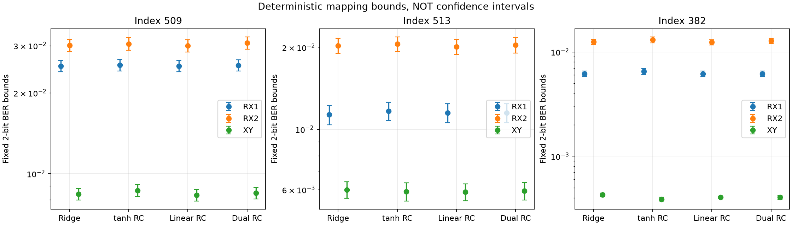

## 5. 预算、时间和特征价值

|模型|线性/tanh节点|输入直通|读出实维|训练实参数|固定随机实参数|λ|
|---|---|---|---|---|---|---|
|ridge_low|0/0|True|231|462|0|1e-05|
|tanh80_low|0/80|True|311|622|24880|1e-05|
|linear80_low|80/0|True|311|622|24880|1e-05|
|dual40_reg|40/40|True|311|622|21680|0.01|
|tanh160_low|0/160|True|391|782|62560|1e-05|
|linear160_low|160/0|True|391|782|62560|1e-05|
|dual40_low|40/40|True|311|622|21680|1e-05|
|dual80_low|80/80|True|391|782|49760|1e-05|
|dual80_states_only|80/80|False|161|322|49760|1e-05|

40+40双分支与80节点单分支同为311读出维、622训练参数；80+80与160单分支同为391维、782参数。共享输入直通均230维，偏置1维。双分支块对角递归的固定权重数/乘加成本比同总节点的单块更少，但有两次状态循环和不同激活，因此这是匹配总节点及读出维度的对照，**不是严格等计算量**。模型没有可训练的隐藏层参数；共同波形前端不计入表。

|同λ=1e−5模型|总节点|验证均值上界|509测试均值上界|513测试均值上界|382测试均值上界|
|---|---|---|---|---|---|
|tanh80_low|80|0.023356|0.022624|0.013586|0.007077|
|linear80_low|80|0.023151|0.022236|0.013371|0.006690|
|dual40_low|80|0.023647|0.022484|0.013457|0.006870|
|tanh160_low|160|0.023972|0.023357|0.013853|0.007516|
|linear160_low|160|0.023288|0.022226|0.013368|0.006690|
|dual80_low|160|0.023741|0.022657|0.013541|0.007067|

在相同总节点、相同λ的对照中，双分支测试综合上界可以低于对应tanh单分支，但仍高于对应线性RC；且验证区40+40不优于tanh80。这个局部相对收益已完整保留，不代表双分支超越最强基线。

下面为509本次单次墙钟秒数：每通道训练10000符号、验证10000、测试31200；均衡器计时不含共同前端或模型磁盘加载。训练包含构造/状态与岭拟合，不含额外诊断。计时不等于实时硬件速度；完整其它工况训练/推理时间也随结果JSON保存。

|模型|通道|训练秒|验证推理秒|测试推理秒|
|---|---|---|---|---|
|ridge_low|rx1|0.01406|0.00271|0.03437|
|ridge_low|rx2|0.00786|0.00324|0.00853|
|tanh80_low|rx1|0.05288|0.03823|0.15612|
|tanh80_low|rx2|0.04777|0.03767|0.11632|
|linear80_low|rx1|0.04248|0.03319|0.10314|
|linear80_low|rx2|0.04223|0.03345|0.10477|
|dual40_reg|rx1|0.06949|0.06379|0.19322|
|dual40_reg|rx2|0.06911|0.06447|0.18916|
|tanh160_low|rx1|0.09598|0.04639|0.18336|
|tanh160_low|rx2|0.07579|0.05593|0.15109|
|linear160_low|rx1|0.07175|0.04224|0.12582|
|linear160_low|rx2|0.06033|0.04126|0.12412|
|dual40_low|rx1|0.07147|0.06223|0.19185|
|dual40_low|rx2|0.06996|0.06271|0.19096|
|dual80_low|rx1|0.08206|0.06841|0.21610|
|dual80_low|rx2|0.08022|0.06818|0.21761|
|dual80_states_only|rx1|0.07303|0.06528|0.20577|
|dual80_states_only|rx2|0.07454|0.06160|0.20816|

### 两分支是否提供不同信息

只用训练状态拟合投影，在509验证状态上检查残差。选定40+40分支：线性状态无法由当前窗口解释的方差比例仅RX1 0.1014%、RX2 0.1101%；非线性状态的该比例为19.42%/18.50%，在同时给出输入和线性状态后仍为19.37%/18.43%。因此两分支并非数值复制，但线性分支大部分已包含在直通输入中，非线性状态的独特变化也未证明是预测目标所需的信息。线性递归实际上是输入的稳定线性时间滤波，可补充窗口外历史和改变正则化几何，不会凭Identity本身产生非线性。

40+40读出名义311维，训练矩阵在相对奇异值阈值1e−10下秩293；80+80名义391维、秩336。选定λ=0.01的正规矩阵条件数约2.93e7/2.45e7，低λ双分支则约2.9e10以上。冗余使条件数恶化。独立SVD核查在所有9个冻结模型/两通道的有效验证区最大预测差7.49e−9；主方法约3.59e−12，支持本次有效区预测的数值可靠性。

数值审计也保留了一次失败日志：最初把未评分重置边缘一起检查时，linear80最大差1.19e−5超过临时1e−5检查阈值。随后分别报告全段与既有保护mask，最大全段差6.45e−5，有效区仍≤7.49e−9。没有改动任何模型权重、保护区或测试规则；边缘差异不得隐去。SVD仅为数值核验，正式预测仍来自已冻结原正规方程解。

纯状态80+80压缩掉230维直通后，验证综合上界0.3804，三个工况测试也明显失败。这是具体随机状态、预算与参数下的信息保留不足的证据，不能据此证明所有无直通RC都不可能工作。相同λ的预算对照与主模型全部保留；没有将节点增加等同于结构贡献。

## 6. 研究判断与下一步

**本轮不支持“线性＋非线性RC特征融合稳定优于强线性/单分支”这一假设。** 验证期D家族最优上界均值0.023630，A为0.023160、B为0.023356、C为0.023151。509/513中双分支没有稳定胜过最强线性方法；382 XY有局部差异但auto位宽会改变排序。主双分支对本轮固定参数LMS有改善，不代表优于充分调优的LMS，更不能据此证明双分支设计必要。

当前更合适的解释是：长窗口和线性读出已吸收大部分可用信息，线性状态冗余，而新增tanh特征未给出稳定增益。共同前端已有Volterra非线性可能降低后级非线性需求，这是待验证解释而非本轮因果结论。本轮仅一个固定seed、两个额外工况、同一载荷，没有多seed置信区间或独立新数据总体推断。小的误码差不应表述为统计显著。

建议下一步优先：

1. **残差/正交化特征融合**：训练区先拟合线性预测及状态投影，再让非线性分支补充残差；用训练尺度标准化与分块Ridge控制冗余，仍保留总维度对照，不引入MLP。
2. **有依据地改善非线性特征**：固定小规模seed集合和输入增益，检查饱和、残差预测力；对比在共同Volterra前端之后是否还有稳定的非线性残差。不要复用本轮测试选择新配置。
3. **新载荷、封存采集验证及解码契约**：使用不同Tx随机序列或新采集，事前锁定工况和超参数；与课程方明确非法PAM4的最终接收规则，才报告唯一物理2-bit BER。

## 7. 接口、测试与复现

`src/dsp_rc/fusion.py`提供`LinearReservoir`、`FusionModel`及18候选。`fit(z_train,y_train,mask)`只拟合训练scale和Wout；`extract(z)`返回input(T,230)、states字典、features(T,F)、final_states；`transform(z)`额外返回prediction(T,)复数；`predict(z)`无标签入口；`save/load`无pickle，存实际矩阵、完整配置、scale、Wout与复杂度。每次extract/transform重置状态，应传完整单段；不能把任意分块当作居中窗口的连续在线处理。

18/18 unittest通过（原13项＋新增5项），新增覆盖Identity闭式递推、仿射叠加/收缩、拒绝不稳定参数、状态续接、共同特征维度、只用mask内标签、序列推理不改权重、保存重载一致，以及单tanh预测与Phase2完全一致。小样本只用原训练段的前3000训练/随后1000检查，两个通道端到端通过。Phase3没有另运行MATLAB；Phase2共享矩阵数值验证已复用，新增Identity/融合以独立闭式与SVD检查为证据，不能称为新的MATLAB逐阶段认证。

在`/Users/oliver/Desktop/DSP/rc_baseline`运行，现有环境无需安装依赖，输出必须使用新目录：

```bash
export PYTHONPATH=src OPENBLAS_NUM_THREADS=1 OMP_NUM_THREADS=1
.venv/bin/python -m unittest discover -s tests -v
.venv/bin/python -m dsp_rc.phase3 prepare --out runs/phase3_reproduce
.venv/bin/python -m dsp_rc.phase3 smoke --out runs/phase3_reproduce
.venv/bin/python -m dsp_rc.phase3 search --out runs/phase3_reproduce
.venv/bin/python -m dsp_rc.phase3 fit-extra --out runs/phase3_reproduce
.venv/bin/python -m dsp_rc.phase3_numerics --out runs/phase3_reproduce
.venv/bin/python -m dsp_rc.phase3 evaluate --out runs/phase3_reproduce
.venv/bin/python -m dsp_rc.phase3_report --out runs/phase3_reproduce
```

复跑只能称同一数据的复验，不能恢复盲测性质。`prepare`拒绝已有目录，`evaluate`在开始时落盘标记并拒绝重复执行。算法与模型哈希在测试前冻结，推理后核对；报告脚本只读现成预测，未重新训练或调用预测。

关键文件：`protocol.json`预声明、`smoke.json`轻量验证、`validation_results.json`全部训练/验证指标、`frozen_algorithm.json`家族选择、`frozen_all_models.json`全部工况模型冻结、`test_results.json`完整测试、`metrics.csv`平表、`feature_diagnostics_validation.json`冗余诊断、`independent_svd_validation_check.json`数值核验、`verification.json`旧文件及预测一致性。每个`index*/`保存模型NPZ、源文件manifest、测试预测(mask及全局符号ID)、星座图；新工况另有前端模型与仅训练区的校准记录。`source_manifest_final.json`登记新增交付源码/测试哈希。未实现可选输出加权融合或MLP，以保持本组共同读出方法的范围。
