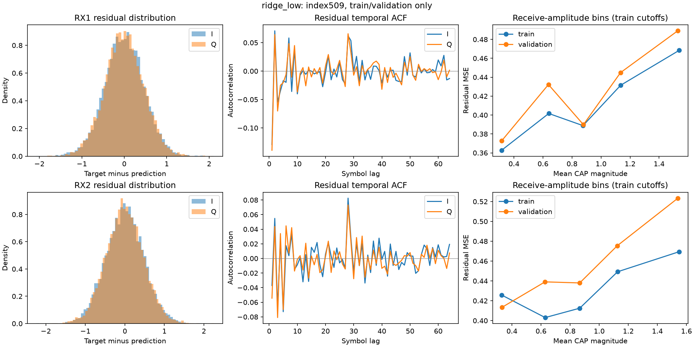
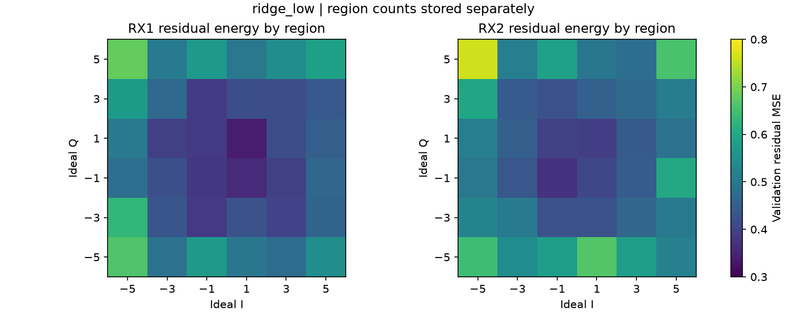
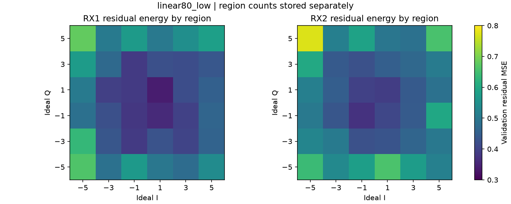
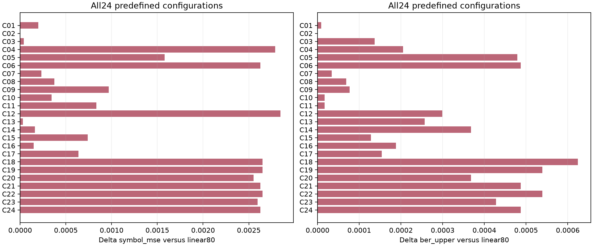
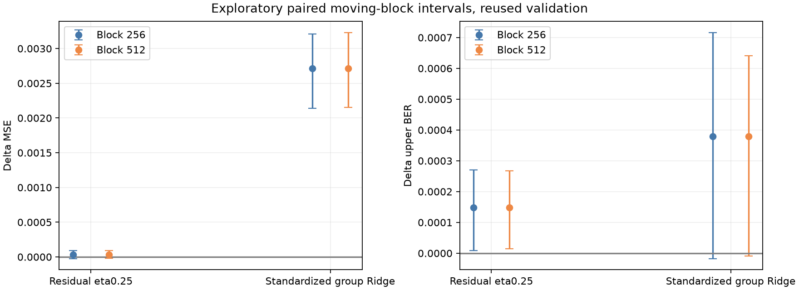

# DSP第四阶段：残差驱动的双分支RC特征融合研究

**结论：本轮未发现稳定的非线性残差预测增益，已按预声明规则止损。** 在两种线性基础×两种状态处理的四组残差方案中，验证选择均回到eta=0。最优非零修正在三种固定非线性种子下都略微增加MSE和固定2-bit BER上界；分组Ridge也没有超过线性RC。不继续扩大搜索，不调用509/513/382旧测试区，不宣称新模型获胜。

已完成24个主要配置、2个固定设计×3种子诊断、23项单元测试、小样本接口验证、残差结构图和成套模型/指标留档。前三阶段源码/模型/结果保留。研究限于NLTCP index509的原训练与验证区，所有“验证”结果均属开发证据，不是独立新载荷测试。

## 1. 协议与数据边界

完整阅读并复用第三阶段REPORT、fusion.py、协议、18候选训练/验证结果和全部最终消融；这些历史结果用于确认基线和提出研究问题，没有作为本轮模型选择的数据区。沿用已核验的波形前端、CAP/RRC、sps=4、115复符号居中窗口、NLTCP解码与评分函数。共同前端已经含Volterra非线性，“线性基础”指符号均衡器，并非整条接收链全线性。

|分段|全局1-based区间|真正拟合/计分区间|有效复符号|
|---|---|---|---|
|训练|1–10000|129–9872|9744|
|验证|10001–20000|10129–19872|9744|
|历史测试|20001–51200|本轮不处理/不评分|0|

每段独立预处理与重置储备池；128符号双端保护、115窗口含未来57符号，仍是离线S2S。加载器按整文件哈希校验后，立即丢弃第20000符号之后的数据，实验函数仅接受两段训练/验证输入。旧测试文件只可能参与完整性哈希核验，未作模型预测或计分。所有scale、均值/方差、投影矩阵与读出仅由训练mask拟合。验证标签用于选择eta和比较方案；未回填训练。

候选与止损规则在运行前写入protocol.json。训练区3000符号/随后1000符号的smoke只验证接口与持久化；其共同前端来自原完整训练区，故不称为独立小样本泛化实验。正式23项测试另覆盖训练标签mask、训练尺度隔离、预测不改权重、eta=0和等价变换。

## 2. 线性模型残差的结构

分析两种基线：输入窗口Ridge与Identity线性RC80。残差为目标减预测，均使用原理想符号I/Q尺度。下表为验证区；训练区全部统计、64阶ACF、分位数、偏度/峰度、状态相关矩阵均保存在residual_diagnostics.json。

|基线|通道|I均值 / 方差|Q均值 / 方差|I/Q lag1 ACF|幅度相关|
|---|---|---|---|---|---|
|ridge_low|rx1|-0.00119 / 0.21459|0.00134 / 0.21030|-0.1292 / -0.1393|0.0773|
|ridge_low|rx2|-0.00081 / 0.23153|-0.00398 / 0.22615|-0.0371 / -0.0544|0.0707|
|linear80_low|rx1|-0.00126 / 0.21482|0.00128 / 0.21038|-0.1289 / -0.1396|0.0778|
|linear80_low|rx2|-0.00069 / 0.23141|-0.00454 / 0.22554|-0.0374 / -0.0563|0.0710|

残差均值接近0但不是完全白噪声；RX1一阶负相关约−0.13/−0.14，RX2更弱。残差绝对值与接收CAP幅度相关约0.07–0.08，说明只有弱幅度依赖。幅度分箱阈值完全来自训练区，验证沿用；不能把这些相关直接等同于可预测非线性。




|基线|通道|外层符号比例|外层残差能量占比|外层/内层MSE|最大状态相关 I/Q|
|---|---|---|---|---|---|
|ridge_low|rx1|23.40%|28.41%|0.51584 / 0.39711|0.0318 / 0.0264|
|ridge_low|rx2|23.40%|28.13%|0.55018 / 0.42945|0.0344 / 0.0336|
|linear80_low|rx1|23.40%|28.40%|0.51614 / 0.39743|0.0319 / 0.0265|
|linear80_low|rx2|23.40%|28.17%|0.55021 / 0.42849|0.0343 / 0.0334|

外层定义为理想I或Q绝对值等于5。它占约23.4%的符号，贡献约28%的残差能量，存在温和的高电平误差集中；并非错误几乎全在高幅度区。按真值星座分组只用于诊断，不作为接收端可用输入，也不据此加权训练或后处理。单状态最大相关约0.026–0.034，是80维中取最大值，未经多重比较修正，更不能当作预测价值证据。





## 3. 残差模型、近似正交化和分组惩罚

两分支独立固定矩阵：Identity80（seed200、A算子范数0.6、leak0.7）与tanh80（主seed100、A谱半径0.9、leak0.7）。线性稳定性继续使用第三阶段的有效递归收缩证明。输入230实维按训练最大绝对值缩放。设X为窗口、L为线性状态、H为非线性状态，C=[X,L,1]，F=[C,H]。

$$W_B=\operatorname{Ridge}(B_{tr},Y_{tr};10^{-5}),\quad R_{tr}=Y_{tr}-B_{tr}W_B,\quad B=[X,1]\text{ 或 }[L,X,1].$$

$$P=(C_{tr}^TC_{tr}+0.01I)^{-1}C_{tr}^TH_{tr},\quad E=H-CP,\quad V=[(E-\mu_{tr})/\sigma_{tr},1].$$

原始状态残差方案令P=0；投影方案P仅拟合一次训练区再用于验证，投影系数0.01固定不搜索。由于有Ridge项，这是近似正交化/状态残差化，CᵀE一般不等于0，不声称严格OLS正交。非线性状态逐列标准化，常数列单独处理。

$$W_R=\operatorname{Ridge}(V_{tr},R_{tr};0.01),\quad \hat Y=B W_B+\eta V W_R,\quad\eta\in\{0,0.25,0.5,1\}.$$

线性基础保持冻结，不与修正层共同重新拟合。Ridge基础原始状态方案的线性RC状态虽在公共bank中物化，但不进入预测；它是“Ridge＋非线性修正”控制，不冒充两分支都有效参与。线性RC基础才是两分支都直接参与的残差模型；Ridge基础的投影版本也使用线性状态来定义H的残差。

### 不能把坐标变换包装成新能力

$$\widetilde F=FT,\quad W=T\widetilde W.\quad \|FW-Y\|^2+\lambda\|W\|^2=\|\widetilde F\widetilde W-Y\|^2+\lambda\|T\widetilde W\|^2.$$

训练均值/标准差构成可逆仿射变换（偏置吸收平移）；H→H−CP也是可逆块三角坐标变换。同步将惩罚因子设为sqrt(0.01)T后，模型函数空间与原直接拼接Ridge完全相同。本轮两个equivalent控制在真实验证区预测最大差约1.18e−11，BER完全一致，因此明确不把它们计作能力提升。

若变换后仍使用对角惩罚，则等效于改变原坐标中的正则先验，而不是新增信息。uniform在标准化坐标对所有系数用0.01；group分别给输入0.01、线性状态1、非线性状态10、偏置0.01。std_uniform→std_group只改变分组惩罚；std→orth后再标准化且保持对角惩罚，同时改变了坐标与诱导正则，不能单称为正交化本身贡献。残差目标则另改变了训练次序、冻结约束和eta收缩。若无正则、精确OLS投影、eta=1，部分两步残差回归与联合OLS可等价；本实验并不满足这些条件，不把一般重参数化误认为新非线性能力。

上述坐标等价结论限于保留完整C且全部读出系数可训练的联合模型；顺序残差模型的基础读出冻结，不能自动吸收−CP带来的线性修正，因此不能直接套用同一等价证明。残差方案与标准化联合方案也不是仅改目标的单因素对照：基础λ=1e−5且冻结，联合方案在变换坐标使用0.01/分组惩罚。其差异只能归于整体训练约束与正则化组合，不能全部归功于残差目标。可单独归因的对照是固定修正层的eta变化、同坐标的uniform/group变化，以及同步变换惩罚的等价控制。

新的修正/联合读出通过增广QR最小二乘解[训练特征;惩罚因子]，避免再平方条件数；强线性参考仍调用既有FusionModel保持历史一致。QR数值改善没有被当作模型增益。

## 4. 24个预定义配置与全部验证对照

主seed100，线性seed200；固定输入、拆分和前端，不搜索窗口、隐藏节点数或输入增益。6个既有参考＋12个残差配置（2基础×2状态处理×3正eta）＋6个联合/等价控制=24。四个eta=0是基线别名，不额外训练。每通道共用同一结构/eta，最后RX1/RX2固定0.5/0.5合并。

选择目标首先是三输出复数MSE等权平均，再比BER上界、小eta、名称；三输出相关，这只是工程加权指标，并非三个独立试验。完整train/validation、每通道指标和所有seed在metrics.csv中。下面没有省略任何主要候选。

|ID|配置|验证MSE均值|验证上界均值|验证auto均值|非法率均值|
|---|---|---|---|---|---|
|C01|ridge_low|0.393878236|0.023159551|0.016255017|0.246305%|
|C02|linear80_low|0.393680757|0.023150999|0.016243614|0.244595%|
|C03|linear160_low|0.393719238|0.023287835|0.016340540|0.246305%|
|C04|tanh80_low|0.396467816|0.023356253|0.016357645|0.237753%|
|C05|dual40_reg|0.395261630|0.023629926|0.016528690|0.234332%|
|C06|dual80_reg|0.396307942|0.023638478|0.016540093|0.236043%|
|C07|res_ridge_low_raw_eta0.25|0.393913654|0.023185208|0.016272122|0.246305%|
|C08|res_ridge_low_raw_eta0.5|0.394054017|0.023219417|0.016306331|0.249726%|
|C09|res_ridge_low_raw_eta1|0.394649575|0.023227969|0.016317734|0.249726%|
|C10|res_ridge_low_orth_eta0.25|0.394024763|0.023168103|0.016255017|0.244595%|
|C11|res_ridge_low_orth_eta0.5|0.394515152|0.023168103|0.016232211|0.237753%|
|C12|res_ridge_low_orth_eta1|0.396527516|0.023450328|0.016420361|0.237753%|
|C13|res_linear80_low_raw_eta0.25|0.393709848|0.023407567|0.016426063|0.248016%|
|C14|res_linear80_low_raw_eta0.5|0.393842413|0.023518747|0.016505884|0.249726%|
|C15|res_linear80_low_raw_eta1|0.394417968|0.023279283|0.016312032|0.239464%|
|C16|res_linear80_low_orth_eta0.25|0.393828684|0.023339149|0.016357645|0.241174%|
|C17|res_linear80_low_orth_eta0.5|0.394319404|0.023304940|0.016317734|0.236043%|
|C18|res_linear80_low_orth_eta1|0.396329224|0.023775315|0.016637019|0.237753%|
|C19|joint_std_uniform|0.396329352|0.023689792|0.016574302|0.236043%|
|C20|joint_std_group|0.396232392|0.023518747|0.016454570|0.234332%|
|C21|joint_std_equivalent|0.396307942|0.023638478|0.016540093|0.236043%|
|C22|joint_orth_uniform|0.396330539|0.023689792|0.016574302|0.236043%|
|C23|joint_orth_group|0.396277803|0.023578612|0.016494481|0.234332%|
|C24|joint_orth_equivalent|0.396307942|0.023638478|0.016540093|0.236043%|




四组eta选择结果：

|残差家族|包括eta=0后的选择|
|---|---|
|ridge_low_raw|ridge_low|
|ridge_low_orth|ridge_low|
|linear80_low_raw|linear80_low|
|linear80_low_orth|linear80_low|

### 主要方法逐通道指标

|ID|输出|MSE|固定2-bit下界–上界|历史auto BER|非法率|
|---|---|---|---|---|---|
|C01|rx1|0.424895|0.024374–0.027401|0.019260|0.3028%|
|C01|rx2|0.457699|0.028684–0.032122|0.022561|0.3438%|
|C01|xy|0.299041|0.009031–0.009955|0.006944|0.0924%|
|C02|rx1|0.425211|0.024117–0.026991|0.018935|0.2874%|
|C02|rx2|0.456971|0.028505–0.032097|0.022595|0.3592%|
|C02|xy|0.298861|0.009493–0.010365|0.007201|0.0872%|
|C03|rx1|0.425234|0.024374–0.027299|0.019157|0.2925%|
|C03|rx2|0.457037|0.028582–0.032174|0.022646|0.3592%|
|C03|xy|0.298886|0.009519–0.010391|0.007218|0.0872%|
|C04|rx1|0.427895|0.024631–0.027299|0.019072|0.2668%|
|C04|rx2|0.460808|0.028967–0.032456|0.022800|0.3489%|
|C04|xy|0.300701|0.009339–0.010314|0.007201|0.0975%|
|C05|rx1|0.427209|0.024708–0.027632|0.019379|0.2925%|
|C05|rx2|0.458611|0.029300–0.032533|0.022766|0.3233%|
|C05|xy|0.299964|0.009852–0.010725|0.007440|0.0872%|
|C06|rx1|0.428079|0.024708–0.027376|0.019123|0.2668%|
|C06|rx2|0.460243|0.029454–0.032943|0.023125|0.3489%|
|C06|xy|0.300602|0.009673–0.010596|0.007372|0.0924%|
|C13|rx1|0.425221|0.024323–0.027248|0.019123|0.2925%|
|C13|rx2|0.457042|0.029044–0.032687|0.023006|0.3643%|
|C13|xy|0.298867|0.009416–0.010288|0.007150|0.0872%|
|C07|rx1|0.424907|0.024477–0.027453|0.019277|0.2976%|
|C07|rx2|0.457787|0.028659–0.032148|0.022595|0.3489%|
|C07|xy|0.299046|0.009031–0.009955|0.006944|0.0924%|
|C16|rx1|0.425413|0.024194–0.026965|0.018883|0.2771%|
|C16|rx2|0.457129|0.029044–0.032635|0.022954|0.3592%|
|C16|xy|0.298944|0.009544–0.010417|0.007235|0.0872%|
|C19|rx1|0.428097|0.024733–0.027401|0.019140|0.2668%|
|C19|rx2|0.460277|0.029505–0.032995|0.023160|0.3489%|
|C19|xy|0.300614|0.009750–0.010673|0.007423|0.0924%|
|C20|rx1|0.428011|0.024784–0.027453|0.019174|0.2668%|
|C20|rx2|0.460139|0.029300–0.032738|0.022971|0.3438%|
|C20|xy|0.300547|0.009442–0.010365|0.007218|0.0924%|
|C23|rx1|0.428036|0.024759–0.027427|0.019157|0.2668%|
|C23|rx2|0.460216|0.029505–0.032943|0.023108|0.3438%|
|C23|xy|0.300582|0.009442–0.010365|0.007218|0.0924%|

## 5. 非线性状态究竟有没有额外预测价值

直接考察修正层预测真实线性残差的能力，而不是比较两个状态矩阵是否不同。下表取eta=1，R²定义为1−均衡后残差MSE/基础残差MSE，不减去验证残差均值；这是相对于“零修正”的增量R²。正值代表改善，负值代表恶化。

|基础|状态|输出|训练增量R²|验证增量R²|
|---|---|---|---|---|
|ridge_low|原始|rx1|0.002033|-0.001597|
|ridge_low|原始|rx2|0.002528|-0.002592|
|ridge_low|原始|xy|0.002402|-0.001501|
|ridge_low|近似正交|rx1|0.006764|-0.007070|
|ridge_low|近似正交|rx2|0.007873|-0.007027|
|ridge_low|近似正交|xy|0.007717|-0.005777|
|linear80_low|原始|rx1|0.002029|-0.001564|
|linear80_low|原始|rx2|0.002471|-0.002411|
|linear80_low|原始|xy|0.002364|-0.001488|
|linear80_low|近似正交|rx1|0.006751|-0.006996|
|linear80_low|近似正交|rx2|0.007874|-0.007079|
|linear80_low|近似正交|xy|0.007702|-0.005807|

对任一固定修正 $\hat r$，$\Delta\mathrm{MSE}(\eta)=\eta^2E|\hat r|^2-2\eta\Re E[r^*\hat r]$。`residual_predictability.json`保存这两个项，避免把很小的残差/状态相关夸大成预测收益。训练可解释部分增加而验证增量R²为负，符合有限样本额外特征拟合训练扰动的现象；不能由此证明所有非线性信息不存在。

正交化使修正不再主要复述输入/线性状态，但也未带来验证收益。主seed下最好的非零修正是线性RC基础＋原始标准化H、eta=0.25，其平均MSE仍比基础增加0.00002909。eta=0在本预定义网格中胜出；没有据此再试更小eta、更多节点或更多seed追求低BER。

## 6. 固定多种子、配对时序重采样与止损

按协议对最优非零残差和最优非等价联合设计，固定结构、lambda和eta，检查非线性seed100/101/102；线性seed200保持不变，专门检查非线性初始化敏感性。不选择表现最好的seed。这是额外初始化诊断，不是新数据独立重复；也没有覆盖线性储备池的种子方差。

|设计|非线性seed|验证MSE均值|验证上界均值|
|---|---|---|---|
|res_linear80_low_raw_eta0.25|100|0.393709848|0.023407567|
|res_linear80_low_raw_eta0.25|101|0.393714572|0.023227969|
|res_linear80_low_raw_eta0.25|102|0.393712333|0.023262178|
|joint_std_group|100|0.396232392|0.023518747|
|joint_std_group|101|0.396631518|0.023475985|
|joint_std_group|102|0.396319005|0.023595717|

主协议要求三seed均降低MSE、平均至少0.1%增益、无seed恶化BER上界，并且两种块长的配对区间均支持两指标下降。门槛只是事前工程止损标准，不是普适显著性定义。两个设计均不通过：

|设计|三seed平均MSE相对收益|通过门槛|
|---|---|---|
|res_linear80_low_raw_eta0.25|-0.008000%|False|
|joint_std_group|-0.689276%|False|

连续256/512符号移动块，各2000次、固定seed404。先在完整验证序列解码出每符号MSE和BER上界贡献，再对相同位置块配对重采样，不将拼接后的块重新解码，以免引入假边界；所有通道和种子使用相同索引。先对seed损失差取均值，保留通道相关性。块长超过115窗口，属于两种预定敏感性检查，不保证完全消除所有长程相关。

|设计|块长|ΔMSE 95%区间|ΔBER上界 95%区间|
|---|---|---|---|
|res_linear80_low_raw_eta0.25|256|-2.3096739e-05 / 9.2125023e-05|8.5522715e-06 / 0.00027082193|
|res_linear80_low_raw_eta0.25|512|-1.7125295e-05 / 9.3758671e-05|1.4253786e-05 / 0.00026797117|
|joint_std_group|256|0.00213857 / 0.0032096789|-1.7247081e-05 / 0.00071554005|
|joint_std_group|512|0.0021532666 / 0.0032271897|-8.6235404e-06 / 0.00064149163|



差值为新方法减线性RC，负值才有利。非零残差修正的MSE区间跨0，BER上界区间偏正；分组联合读出的MSE区间明显偏正。**这些是反复使用的验证集上、选模之后的探索性区间，没有做选择偏差/多重比较校正，不能作为独立确认性置信声明。** 即使不依赖区间，三seed原始点估计也未满足止损条件。

## 7. 参数预算、运行时间与复用接口

公共80+80 bank含49760个固定随机实系数。输入Ridge为231维读出，linear80/tanh80为311，linear160/dual80为391；dual40也是311。残差模型另有81维修正（80状态＋偏置）：Ridge基础总读出系数624，linear80基础784；与联合80+80的782接近，但两步优化约束不同、偏置重复，不能称完全等参数。Ridge原始状态修正的线性bank不影响输出，属于控制方案。

投影矩阵311×80=24880个**训练拟合的无监督系数**，不能漏计成固定随机参数；均值/标准差也训练估计。表中将它们与目标读出参数分列。等价控制存储稠密变换T只是推导出来的表示，不是新增自由参数。推理当前残差实现复用base.predict，线性基线状态可能重复计算；没有宣称计算最优或实时性。

|ID|目标读出参数|投影拟合系数|RX1训练/推理秒|RX2训练/推理秒|
|---|---|---|---|---|
|C01|462|0|0.01370 / 0.00304|0.00709 / 0.00294|
|C02|622|0|0.05166 / 0.03277|0.04199 / 0.03275|
|C03|782|0|0.06998 / 0.04004|0.06150 / 0.03881|
|C04|622|0|0.04338 / 0.03716|0.04457 / 0.03743|
|C05|622|0|0.06938 / 0.06182|0.06923 / 0.06282|
|C06|782|0|0.08246 / 0.06894|0.08080 / 0.06829|
|C07|624|0|0.09010 / 0.07322|0.08718 / 0.07621|
|C08|624|0|0.08767 / 0.07426|0.08786 / 0.07380|
|C09|624|0|0.08687 / 0.07443|0.08645 / 0.07417|
|C10|624|24880|0.09284 / 0.07406|0.09254 / 0.07346|
|C11|624|24880|0.09202 / 0.07398|0.09280 / 0.07374|
|C12|624|24880|0.09292 / 0.07332|0.09249 / 0.07325|
|C13|784|0|0.15740 / 0.10656|0.15527 / 0.10243|
|C14|784|0|0.15321 / 0.10498|0.15511 / 0.10525|
|C15|784|0|0.15712 / 0.10507|0.15447 / 0.10348|
|C16|784|24880|0.16088 / 0.10296|0.15927 / 0.10375|
|C17|784|24880|0.16066 / 0.10477|0.16108 / 0.10423|
|C18|784|24880|0.15818 / 0.10400|0.15994 / 0.10342|
|C19|782|0|0.21437 / 0.07701|0.19631 / 0.07744|
|C20|782|0|0.19574 / 0.07617|0.19987 / 0.07635|
|C21|782|0|0.19417 / 0.07828|0.19255 / 0.07731|
|C22|782|24880|0.20101 / 0.07705|0.20065 / 0.07676|
|C23|782|24880|0.20343 / 0.07658|0.20099 / 0.07703|
|C24|782|24880|0.20093 / 0.07624|0.19918 / 0.07734|

每次训练/推理段均10000符号，评分9744；计时为本机单次墙钟、不含共同前端与磁盘保存。搜索中的特征bank初始化复用，bank_setup_seconds另存；残差训练包含重拟合其线性基础。额外seed没有复用bank，时间不能直接解读为相同工作量基准。

`src/dsp_rc/residual_fusion.py`提供FeatureBank、ResidualFusion、coordinate_transform与penalized_lstsq。fit仅接收训练z/y/mask；components(z)返回基础预测及单位eta修正；predict(z,eta=None)按配置融合，无标签入口；save/load保存实际矩阵、投影、尺度、读出和配置。所有候选/seed的重载预测逐元素一致。正式开发的eta=0优胜意味着部署选择现有线性基线，不能把非零诊断候选误称为胜出模型。

### 条件数改善不等于预测增益

|设计|RX1增广矩阵κ₂|RX2增广矩阵κ₂|
|---|---|---|
|raw_dual80_reg|6551.99|6278.55|
|joint_std_uniform|3204.89|3357.58|
|joint_std_group|530.30|565.00|
|joint_orth_uniform|2901.78|3028.31|
|joint_orth_group|480.13|509.58|
|joint_std_equivalent|3232.11|2926.35|
|joint_orth_equivalent|2925.91|2638.95|

正规矩阵条件数是表中数值的平方。分组惩罚将增广矩阵条件数从约6300–6500降至约480–565，但验证性能仍较差；不能把数值条件改善解释为获得非线性信息。近似正交化后训练H剩余方差比例为RX1 18.456%、RX2 17.441%，归一化||CᵀE||约4.13e−7/4.71e−7；投影确实去除了线性可解释部分，仍未产生验证残差增益。

## 8. 新载荷证据与NLTCP解码规则

本地发现不同Tx参考文件，不能笼统说“只有一个Tx文件”：

|Tx txt|样本形状|与RF参考训练前缀相关|
|---|---|---|
|RF0.105_data36QAM.txt|[204800]|1.000000|
|data36QAM.txt|[204800]|-0.006785|
|data36qamQAM.txt|[204800]|0.845761|
|data49QAM.txt|[204800]|0.000629|
|pre_SNRest_36QAM.txt|[204800]|0.937739|

早期Sheet1/2指向data36QAM.txt，后期Sheet3/等高线图指向RF0.105_data36QAM.txt；前者不同哈希且零延迟相关很低，是不同参考波形的明确证据，但仍不能排除不同成形/载频/移位，更不能在缺乏对应标签时称为独立消息。仅发现一套v1/v2与decimal_PAM4_1/2，尚无可验证的另一组完整NLTCP载荷包。Data目录64APSK是另一任务。没有拿这些不完整候选试模型、挑结果。

具体数据请求见[NEW_PAYLOAD_REQUEST.md](../../rc_baseline/runs/phase4_residual_fusion/NEW_PAYLOAD_REQUEST.md)：要求payload_id/随机种子、两份原PAM4消息、对应理想符号、编码状态、Tx成形参数、RX1/RX2及逐帧配对元数据。需要先核实旧data36QAM是否确为另一消息，能补齐则可另立验证协议；否则向助教索取新随机载荷采集。本轮方法未过门槛，暂不进入最终新载荷性能宣称。

非法PAM4规则单独整理于[NLTCP_DECODER_QUESTIONS.md](../../rc_baseline/runs/phase4_residual_fusion/NLTCP_DECODER_QUESTIONS.md)。维持原解码4/5，不截断、不取模、不按答案映射。固定2-bit范围为[E/(4N),(E+2U)/(4N)]，非法率U/(2N)；这只是未定义映射的确定性界限，不是物理BER精确值或置信区间。历史auto逐I/Q按最大整数定宽。每方法同一mask；完整位宽和计数在CSV/JSON。向助教确认编码/解码状态、非法输出处理、自然/Gray映射、分母、擦除计错和首尾标签。未发送任何外部消息。

## 9. 结论、限制与复现

**当前不值得继续扩大这一固定前端、115窗口、随机tanh状态的搜索。** 第四阶段的价值在于将“状态不同”与“残差可预测”分开，并实测坐标等价控制。当前非线性状态对训练残差有拟合作用，却没有在预定验证网格及三seed检查中产生稳定增量；保持eta=0、保留强线性基线是本轮明确决策。

限制包括单工况、同一反复用于研究的验证区、一个线性seed、三个非线性seed、有限eta/正则网格、共同前端已含Volterra、训练残差来自样本内拟合，以及未解决的非法PAM4输出。不能从本轮否定一切非线性方法或任意更小eta；也不能因个别通道BER下降挑选局部结论。若后续另有物理信道机制依据，可事前定义不同特征/训练内交叉拟合研究，但本轮不继续追参数。优先补齐新载荷与解码契约。

复现：在`/Users/oliver/Desktop/DSP/rc_baseline`使用已有环境，新输出目录必须不存在。以下只复验开发结果，不会恢复独立盲测性质。

```bash
export PYTHONPATH=src OPENBLAS_NUM_THREADS=1 OMP_NUM_THREADS=1
.venv/bin/python -m dsp_rc.phase4 prepare --out runs/phase4_reproduce
.venv/bin/python -m unittest discover -s tests -v > runs/phase4_reproduce/unit_tests_final.log 2>&1
.venv/bin/python -m dsp_rc.phase4_diagnostics --out runs/phase4_reproduce
.venv/bin/python -m dsp_rc.phase4 smoke --out runs/phase4_reproduce
.venv/bin/python -m dsp_rc.phase4 search --out runs/phase4_reproduce
.venv/bin/python -m dsp_rc.phase4 seeds --out runs/phase4_reproduce
.venv/bin/python -m dsp_rc.phase4_verify --out runs/phase4_reproduce
.venv/bin/python -m dsp_rc.phase4_report --out runs/phase4_reproduce
```

交付：protocol.json预声明；residual_diagnostics.json与图表；candidate_results.json完整24配置；selection.json含eta=0与等价检查；seed_results.json与paired_block_bootstrap.json；decision.json止损；models/全部训练模型；predictions_seed100.npz与seed_validation_predictions.npz仅训练/验证预测；metrics.csv全指标；payload_inventory.json原文件哈希；verification.json保护/测试核验；source_manifest.json新增源码。没有Phase4 test预测文件。
