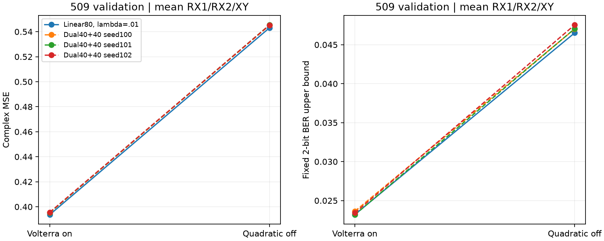
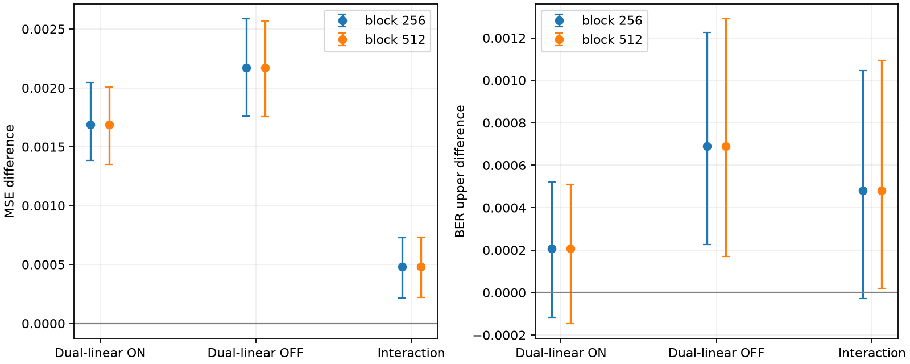
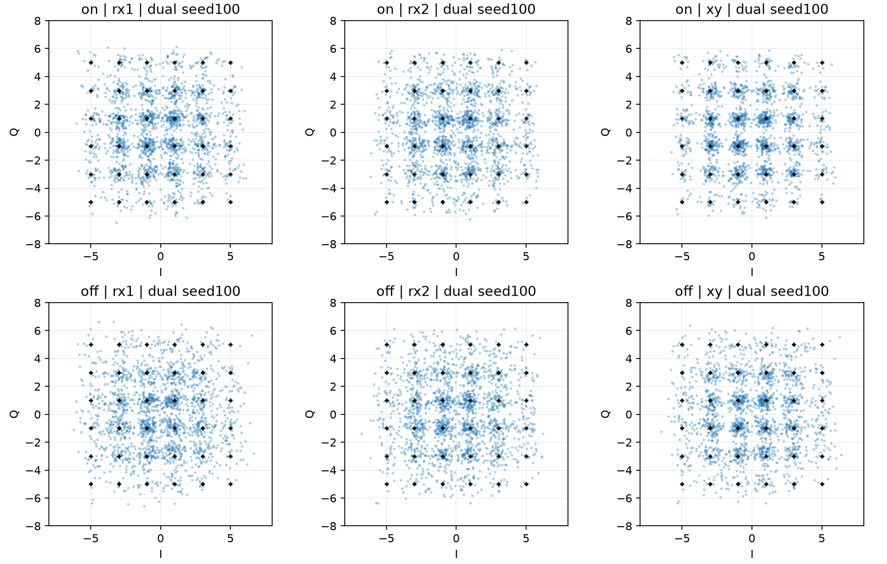

# 第五阶段：有限 Volterra 前端消融（仅训练与验证）

日期：2026-10-17。**实验已完成，未发现关闭前端二次项后双分支增量价值变大的证据。** 关闭二次项使当前后端的绝对验证误差明显增加；双分支三种子在on/off两侧的平均MSE均高于匹配线性RC。预声明潜力门槛未通过，停止本次实验，不扩大搜索、不评价旧测试。

## 1. 事前协议与真实执行边界

`protocol.json`先于小样本训练和完整训练写入；`run_started.json`记录协议SHA-256。完整实验严格12个前端/后端/seed组合、每组合独立RX1/RX2，共24个后端模型；4个前端分别训练一次供所有后端共享。不存在根据结果新增候选或最佳种子选择。

主2×2：有/无波形二次项 × Identity80 / Identity40+tanh40。后端115窗口、230维实输入、311×2共同读出，λ=.01；线性A算子范数.6、tanh谱半径.9、γ=.7；线性seed200、非线性seed100/101/102。两侧另预声明115窗口Ridge λ1e−5与linear80 λ1e−5锚点，不把受限λ线性模型冒充最强基线。线性模型没有非线性随机变量，只拟合一次，不将重复结果算作三个独立seed。

0-based训练[0,10000)、验证[10000,20000)，双端128保护，均计9744符号。加载器只将前80000采样/20000符号转为数值；完整原文件读取仅用于SHA核验（行向量文本可能一次读取整行，但未解析后续数值、预测或计分）。旧509/513/382测试预测文件从未打开。每段独立预处理/储备池重置；115居中窗口仍含未来57符号，属于离线S2S。波形前端监督仅来自训练前10000采样，所有尺度只从训练拟合。对已有前端的复验只读取模型参数并比较训练区，没有旧测试回放。

## 2. 消融实现与公平性

on复用原VolterraLMS，联合训练W和V；off用新增LinearWaveLMS从W=0重新拟合，仅保留逆序居中线性采样窗口：

\[\hat x_t=Wu_t,\quad W\leftarrow W+\mu(x^{Tx}_t-Wu_t)u_t^T.\]

off没有V参数或二次输出，不是把二次学习率设为0，也不是对已联合训练W进行推理损伤。保留RX1 33抽头/.022、RX2 43抽头/.013、单遍10000采样；on二次抽头/步长仍17/8e−5与13/5e−5。相同训练前缀对齐、极性与raw/Tx RMS共享；wave/CAP RMS及后端输入尺度分别在同一训练区重新估计后冻结。CAP固定载频.5625、rolloff.105/span10、phase0、全局采样原点、sps4。后端均在各自前端分布重新拟合，不套旧S2S权重。

四路前端训练相关峰全部lag0，未触发事前暂停规则，未调相位/延迟；509 RX2极性仍−1。on训练W/V和CAP符号与历史冻结前端逐元素一致，off的W确实不同。跨on/off每个后端配置的实际A/Win哈希相同；训练及推理不改变权重，所有模型重载预测一致。

4项新单元测试通过：独立设计矩阵递推核对、off齐次线性且预测不训练、尺度冻结/前端持久化、分段移位不回绕。正式运行前的四条3000/1000小样本路径均通过，完全位于旧训练区，前端也只在小样本训练段拟合；这些只是接口验收，不用来选模型。测试源码在协议之后、任何训练之前补充，核心实验源码及全部继承源码在协议中冻结；没有变更实验设计。最终报告脚本仅读取已保存训练/验证预测并逐字段重新计分核验。

## 3. 全部验证结果

下表聚合为RX1/RX2/XY等权平均，三个输出相关，并不是三份独立试验。auto是历史兼容自动位宽BER，不能等同于固定2-bit物理BER。N=9744，每输出38976真实参考bit；非法I/Q分量数U，合法错误bit数E，固定界限[E/(4N),(E+2U)/(4N)]，非法率U/(2N)。界限是未知非法映射的确定性范围，不是置信区间；未截断非法4/5。

|前端|模型|N seed|MSE|固定下界|固定上界|auto|非法率|
|---|---|---:|---:|---:|---:|---:|---:|
|on|linear80_reg|100|0.393639194|0.020756363|0.023202313|0.016277823|0.24459%|
|on|ridge_low|100|0.393878236|0.020696497|0.023159551|0.016255017|0.24631%|
|on|linear80_low|100|0.393680757|0.020705049|0.023150999|0.016243614|0.24459%|
|on|dual40_reg|100|0.395261630|0.021286604|0.023629926|0.016528690|0.23433%|
|on|dual40_reg|101|0.395223426|0.020722154|0.023185208|0.016272122|0.24631%|
|on|dual40_reg|102|0.395503194|0.021038588|0.023416119|0.016397555|0.23775%|
|off|linear80_reg|100|0.543098019|0.041333128|0.046515805|0.032703886|0.51827%|
|off|ridge_low|100|0.543213469|0.041392994|0.046507252|0.032675379|0.51143%|
|off|linear80_low|100|0.543323561|0.041307471|0.046490148|0.032686782|0.51827%|
|off|dual40_reg|100|0.545092422|0.041786398|0.047020389|0.033051679|0.52340%|
|off|dual40_reg|101|0.545420463|0.041786398|0.047054598|0.033091589|0.52682%|
|off|dual40_reg|102|0.545300516|0.042239669|0.047542077|0.033427978|0.53024%|

### 逐通道完整验证表（无删选）

|前端/模型/seed|输出|MSE|固定下界–上界|auto|非法数/率|I/Q位宽|
|---|---|---:|---|---:|---|---|
|on_linear80_reg_s100|rx1|0.4250777|0.0244253–0.0272989|0.0191400|56 / 0.28736%|3/3|
|on_linear80_reg_s100|rx2|0.4569870|0.0284534–0.0320454|0.0225609|70 / 0.35920%|3/3|
|on_linear80_reg_s100|xy|0.2988529|0.0093904–0.0102627|0.0071326|17 / 0.08723%|3/3|
|on_ridge_low_s100|rx1|0.4248947|0.0243740–0.0274015|0.0192597|59 / 0.30275%|3/3|
|on_ridge_low_s100|rx2|0.4576990|0.0286843–0.0321223|0.0225609|67 / 0.34380%|3/3|
|on_ridge_low_s100|xy|0.2990411|0.0090312–0.0099548|0.0069444|18 / 0.09236%|3/3|
|on_linear80_low_s100|rx1|0.4252109|0.0241174–0.0269910|0.0189347|56 / 0.28736%|3/3|
|on_linear80_low_s100|rx2|0.4569706|0.0285047–0.0320967|0.0225951|70 / 0.35920%|3/3|
|on_linear80_low_s100|xy|0.2988608|0.0094930–0.0103654|0.0072010|17 / 0.08723%|3/3|
|on_dual40_reg_s100|rx1|0.4272094|0.0247075–0.0276324|0.0193794|57 / 0.29249%|3/3|
|on_dual40_reg_s100|rx2|0.4586113|0.0293001–0.0325328|0.0227661|63 / 0.32328%|3/3|
|on_dual40_reg_s100|xy|0.2999642|0.0098522–0.0107245|0.0074405|17 / 0.08723%|3/3|
|on_dual40_reg_s101|rx1|0.4269609|0.0240917–0.0271706|0.0191229|60 / 0.30788%|3/3|
|on_dual40_reg_s101|rx2|0.4587545|0.0288383–0.0322250|0.0226122|66 / 0.33867%|3/3|
|on_dual40_reg_s101|xy|0.2999549|0.0092365–0.0101601|0.0070813|18 / 0.09236%|3/3|
|on_dual40_reg_s102|rx1|0.4270294|0.0240917–0.0268627|0.0188150|54 / 0.27709%|3/3|
|on_dual40_reg_s102|rx2|0.4595599|0.0296336–0.0330716|0.0231938|67 / 0.34380%|3/3|
|on_dual40_reg_s102|xy|0.2999203|0.0093904–0.0103140|0.0071839|18 / 0.09236%|3/3|
|off_linear80_reg_s100|rx1|0.6148194|0.0526991–0.0595751|0.0419232|134 / 0.68760%|3/3|
|off_linear80_reg_s100|rx2|0.5523343|0.0431548–0.0481835|0.0337986|98 / 0.50287%|3/3|
|off_linear80_reg_s100|xy|0.4621403|0.0281455–0.0317888|0.0223898|71 / 0.36433%|3/3|
|off_ridge_low_s100|rx1|0.6145666|0.0528530–0.0596264|0.0419232|132 / 0.67734%|3/3|
|off_ridge_low_s100|rx2|0.5529007|0.0429752–0.0479013|0.0335762|96 / 0.49261%|3/3|
|off_ridge_low_s100|xy|0.4621731|0.0283508–0.0319940|0.0225267|71 / 0.36433%|3/3|
|off_linear80_low_s100|rx1|0.6152524|0.0529300–0.0600113|0.0422824|138 / 0.70813%|3/3|
|off_linear80_low_s100|rx2|0.5524143|0.0433087–0.0481835|0.0337473|95 / 0.48748%|3/3|
|off_linear80_low_s100|xy|0.4623039|0.0276837–0.0312757|0.0220307|70 / 0.35920%|3/3|
|off_dual40_reg_s100|rx1|0.6170734|0.0533662–0.0603448|0.0424535|136 / 0.69787%|3/3|
|off_dual40_reg_s100|rx2|0.5545234|0.0436936–0.0486710|0.0341065|97 / 0.49774%|3/3|
|off_dual40_reg_s100|xy|0.4636805|0.0282995–0.0320454|0.0225951|73 / 0.37459%|3/3|
|off_dual40_reg_s101|rx1|0.6176440|0.0529813–0.0600626|0.0423166|138 / 0.70813%|3/3|
|off_dual40_reg_s101|rx2|0.5546892|0.0444376–0.0495690|0.0347564|100 / 0.51314%|3/3|
|off_dual40_reg_s101|xy|0.4639282|0.0279403–0.0315322|0.0222017|70 / 0.35920%|3/3|
|off_dual40_reg_s102|rx1|0.6171726|0.0538537–0.0607810|0.0427443|135 / 0.69273%|3/3|
|off_dual40_reg_s102|rx2|0.5552598|0.0447968–0.0499795|0.0350472|101 / 0.51827%|3/3|
|off_dual40_reg_s102|xy|0.4634691|0.0280686–0.0318658|0.0224925|74 / 0.37972%|3/3|



## 4. 交互效应与固定种子

定义Δon=MSE(dual,on)−MSE(linear,on)，Δoff同理；交互I=Δoff−Δon，负值才支持关闭二次项后非线性增量变大。双分支先平均三seed逐符号损失，再做配对连续块，不平均预测后重新计分。

|对照|块长|ΔMSE|MSE 95%区间|ΔBER上界|BER上界95%区间|
|---|---:|---:|---|---:|---|
|on_dual_minus_linear80_reg|256|0.001690223|0.001382345 … 0.002047920|0.000208105|-0.000116952 … 0.000521689|
|on_dual_minus_linear80_reg|512|0.001690223|0.001351033 … 0.002007367|0.000208105|-0.000145389 … 0.000510357|
|off_dual_minus_linear80_reg|256|0.002173114|0.001762561 … 0.002585019|0.000689883|0.000225139 … 0.001225826|
|off_dual_minus_linear80_reg|512|0.002173114|0.001757147 … 0.002567817|0.000689883|0.000171045 … 0.001288685|
|interaction|256|0.000482891|0.000214275 … 0.000727679|0.000481778|-0.000028579 … 0.001046370|
|interaction|512|0.000482891|0.000220560 … 0.000731419|0.000481778|0.000019955 … 0.001094691|
|off_dual_minus_ridge_low|256|0.002057665|0.001609382 … 0.002608391|0.000698436|0.000228061 … 0.001245852|
|off_dual_minus_ridge_low|512|0.002057665|0.001582997 … 0.002598163|0.000698436|0.000202332 … 0.001260035|
|off_dual_minus_linear80_low|256|0.001947573|0.001453938 … 0.002450426|0.000715540|0.000133914 … 0.001319901|
|off_dual_minus_linear80_low|512|0.001947573|0.001457332 … 0.002441132|0.000715540|0.000091224 … 0.001357032|
|linear80_reg_off_minus_on|256|0.149458826|0.140624751 … 0.159388475|0.023313492|0.020944299 … 0.025520192|
|linear80_reg_off_minus_on|512|0.149458826|0.140254732 … 0.158857708|0.023313492|0.020935747 … 0.025700431|
|off_dual_minus_on_linear80_low|256|0.151590377|0.142839721 … 0.161555299|0.024054689|0.021753629 … 0.026272649|
|off_dual_minus_on_linear80_low|512|0.151590377|0.142503487 … 0.160818234|0.024054689|0.021750992 … 0.026407134|

每次2000个移动块重采样，块长256/512、seed404；先完整解码再抽取逐符号损失，不能拼块重新解码造成假边界；同位置用于所有条件/seed/输出。这里是反复使用的验证区上的探索性区间，没有独立新消息或总体确认性显著性保证。固定一个线性seed，不能代表所有储备池初始化。

三seed交互MSE点估计均为正；固定线性基线下，移除Volterra后双分支相对劣势没有消失，点估计反而略增。MSE交互在两种块长的探索性区间均为正（约0.00021–0.00073）；BER上界交互在256块长跨0、512块长为正，其稳定性更弱。不能仅凭这些重复使用验证区的区间作总体因果显著性声明。更明确的结果是四格绝对误差及同前端双分支相对线性的差异。on侧seed101的BER上界对主线性对照有局部微小改善，但MSE仍差；不隐藏局部指标，也不凭它挑seed。

事前门槛要求off双分支三seed均降低相对两个off强线性锚点的MSE、BER上界不恶化，两种块长的两指标区间均支持改善，并且交互MSE区间支持负值。本次不通过，`promising_for_new_payload=false`；没有追加配置、输入增益、延迟或超参数。



## 5. 前端分布、复杂度与时间

|前端/通道|线性/二次有效系数|训练更新数|训练CAP相关lag0|wave_scale/cap_scale|验证CAP功率|前端训练/验证预处理秒|
|---|---|---:|---:|---|---:|---|
|on_rx1|33/153|9968|0.953038|1.025209/1.414394|0.979745|0.068220/0.002257|
|off_rx1|33/0|9968|0.955170|1.011276/1.412232|0.979074|0.012500/0.001341|
|on_rx2|43/91|9958|0.928363|0.991430/1.418013|0.989844|0.065862/0.002150|
|off_rx2|43/0|9958|0.926052|0.960844/1.418257|0.990993|0.012880/0.001569|

二次有效参数为上三角153/91；off均为0。前端尺度变化和重新拟合属于处理链的必要变化，不从验证区重新归一化。完整幅度分位数和均值见frontend_results.json。训练CAP相关高并不保证后端MSE更低，不能用单一相关系数替代公平输出评价。

|配置|通道|后端监督/固定随机参数|输入scale|后端训练/验证推理秒|
|---|---|---|---:|---|
|on_linear80_reg_s100|rx1|622/24880|1.989560|0.058642/0.032556|
|on_linear80_reg_s100|rx2|622/24880|2.278614|0.044117/0.033263|
|on_ridge_low_s100|rx1|462/0|1.989560|0.006553/0.002316|
|on_ridge_low_s100|rx2|462/0|2.278614|0.006449/0.002286|
|on_linear80_low_s100|rx1|622/24880|1.989560|0.042489/0.031829|
|on_linear80_low_s100|rx2|622/24880|2.278614|0.043377/0.033403|
|on_dual40_reg_s100|rx1|622/21680|1.989560|0.069835/0.061707|
|on_dual40_reg_s100|rx2|622/21680|2.278614|0.068795/0.062403|
|on_dual40_reg_s101|rx1|622/21680|1.989560|0.069249/0.061856|
|on_dual40_reg_s101|rx2|622/21680|2.278614|0.068979/0.061836|
|on_dual40_reg_s102|rx1|622/21680|1.989560|0.068803/0.061677|
|on_dual40_reg_s102|rx2|622/21680|2.278614|0.067791/0.060656|
|off_linear80_reg_s100|rx1|622/24880|2.029087|0.041023/0.033196|
|off_linear80_reg_s100|rx2|622/24880|2.355608|0.041563/0.032754|
|off_ridge_low_s100|rx1|462/0|2.029087|0.006512/0.002296|
|off_ridge_low_s100|rx2|462/0|2.355608|0.006415/0.002301|
|off_linear80_low_s100|rx1|622/24880|2.029087|0.041362/0.033027|
|off_linear80_low_s100|rx2|622/24880|2.355608|0.041435/0.033282|
|off_dual40_reg_s100|rx1|622/21680|2.029087|0.067175/0.060781|
|off_dual40_reg_s100|rx2|622/21680|2.355608|0.066563/0.061941|
|off_dual40_reg_s101|rx1|622/21680|2.029087|0.067582/0.061460|
|off_dual40_reg_s101|rx2|622/21680|2.355608|0.066595/0.061093|
|off_dual40_reg_s102|rx1|622/21680|2.029087|0.084254/0.057723|
|off_dual40_reg_s102|rx2|622/21680|2.355608|0.073313/0.057809|

每个后端训练与推理均10000符号（评分9744），计时不含共同前端、磁盘保存及评分；前端单列。可将相应前端与后端时间相加估计本次串行管线成本，但不能当作稳定硬件benchmark。双分支固定随机参数21680，线性80为24880，都是622监督读出参数；Ridge为462/0。匹配后端节点和读出维度不是严格等计算量，on更有前端二次项开销。



## 6. 结论与限制

在本次index509、固定波形训练规则和115窗口后端中，保留Volterra二次项有明显的总体性能价值；删除它没有释放出可由当前双分支RC稳定利用的额外预测收益。不能将这推广成“物理信道没有非线性”或“Volterra已经消除了所有非线性”。本实验操纵的是联合训练前端是否包含二次基函数，线性W也随之重新拟合，结论属于这两个训练管线的受控比较，不是固定其他系数后的纯二次项贡献分解。

只观察一个工况、同一消息的已用验证区；off线性前端步长/训练遍数按原规范固定，未优化，不能宣称它是最优纯线性接收机。没有新载荷测试，没有唯一合法PAM4解码规则。既有原始TXT上游处理历史仍不完全清楚。当前不建议为了展示双分支优势删除Volterra，也不建议扩大本轮搜索。优先保留现有强线性＋Volterra方案、统一助教规则及新载荷来源。

## 7. 复现与交付

源码独立在`rc_baseline/volterra_ablation/`，未修改任何历史源码/数据/模型。复现必须新目录，使用已有环境，按顺序：

```bash
cd /Users/oliver/Desktop/DSP/rc_baseline
export PYTHONPATH=src OPENBLAS_NUM_THREADS=1 OMP_NUM_THREADS=1
.venv/bin/python volterra_ablation/experiment.py prepare --out runs/phase5_reproduce
.venv/bin/python -m unittest discover -s volterra_ablation -p 'test_*.py' -v > runs/phase5_reproduce/unit_tests.log 2>&1
.venv/bin/python volterra_ablation/experiment.py smoke --out runs/phase5_reproduce
.venv/bin/python volterra_ablation/experiment.py run --out runs/phase5_reproduce
.venv/bin/python volterra_ablation/report.py --out runs/phase5_reproduce
```

实验入口没有test模式，重复run会拒绝覆盖。`protocol.json`、`run_started.json`、`input_manifest.json`保存事前设计/来源；`models/`为4前端+24后端；`predictions.npz`仅训练/验证；`results.json`/`metrics.csv`完整指标；`seed_effects.json`、`paired_block_results.json`为固定种子与时序配对结果；`decision.json`止损；`unit_tests.log`、`smoke.json`及`verification.json`为验收证据。保存了全部失败方向，没有挑seed或只报有利通道。
